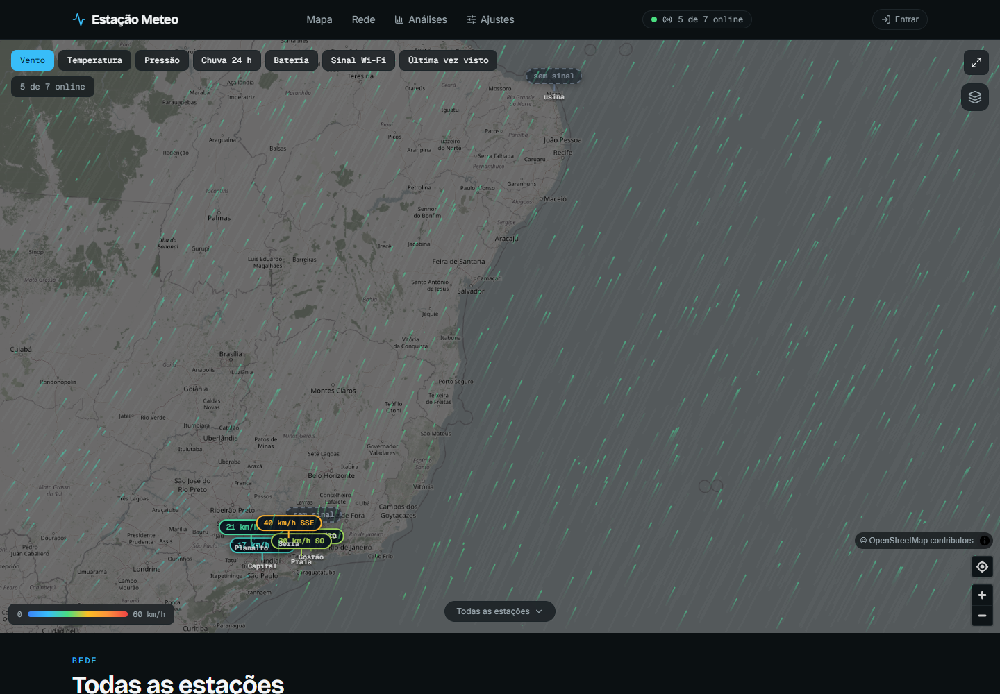
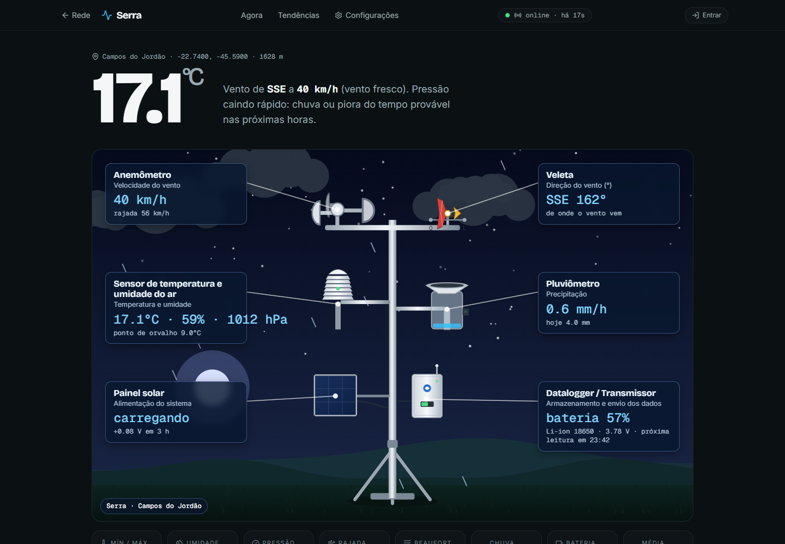
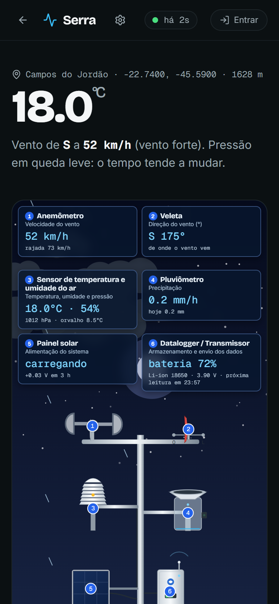
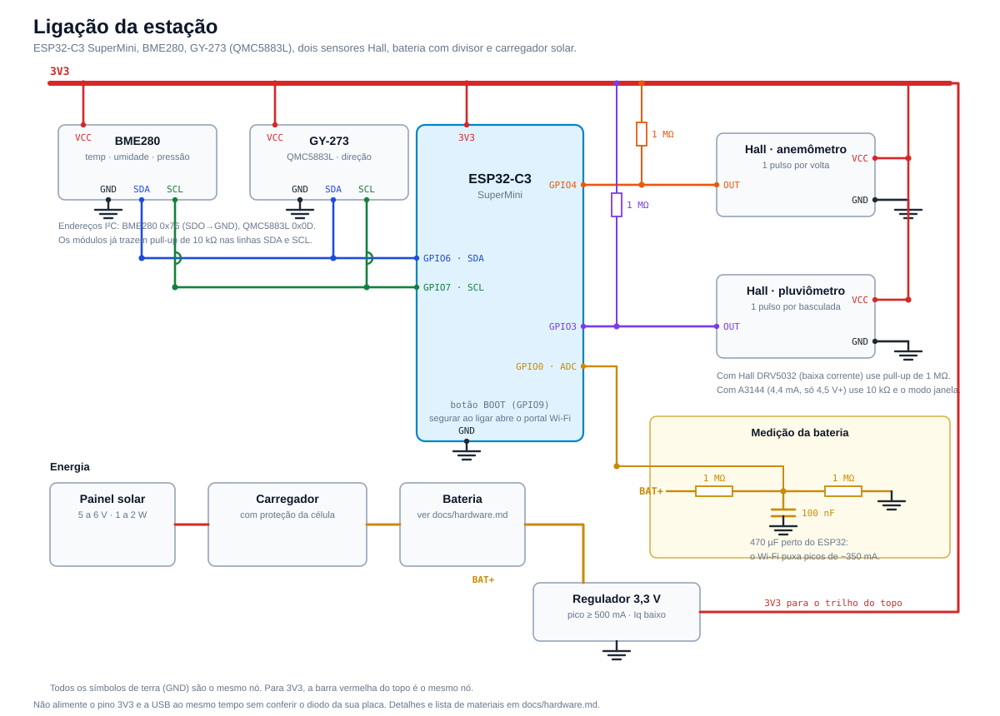
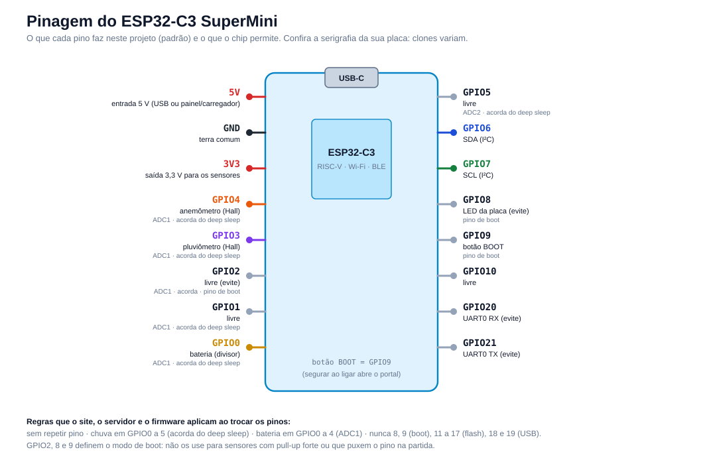

# Estação Meteo

[](https://github.com/rudsomlima/estacao-meteo/actions/workflows/ci.yml)
[](LICENSE)

Estação meteorológica **de baixo consumo com ESP32-C3**, feita para rodar a bateria e painel solar, com um site que mostra uma **rede de estações num mapa**. Mede vento (velocidade, rajada e direção), temperatura, umidade, pressão, chuva e a tensão da bateria.

[English summary](README.en.md)



> **Estado do projeto:** o firmware compila e já foi gravado e testado numa placa ESP32-C3 real (gravação pelo site, configuração pela USB, envio ao servidor), a API tem testes automatizados e o site foi conferido no navegador, mas **os sensores, a eletrônica de campo e o consumo ainda não foram validados em bancada**. Os números de energia são estimativas. Veja [o que falta testar](docs/hardware.md#próximos-testes-de-bancada) e ajude relatando o que você medir.

## O que tem

- **Mapa com várias estações.** Partículas de vento interpoladas entre as estações, pinos com resumo e camadas que se combinam (vento, temperatura, pressão, chuva 24 h, bateria, sinal Wi-Fi, última vez visto), painel de detalhes e tabela da rede.
- **Página da estação** com uma figura animada do equipamento: cada medidor se move com o dado dele (copos, veleta, chuva, painel solar, envio do datalogger) e tem a legenda com o valor ao vivo. Funciona no celular.
- **Gráficos** de 6 h, 24 h e 7 dias, rosa dos ventos e tendências.
- **Energia e telemetria:** tensão, sinal do Wi-Fi, ciclo de sono e **autonomia estimada** que se atualiza enquanto você mexe na configuração.
- **Configuração remota:** a estação baixa a configuração a cada envio. Bateria definida por estação (Li-ion, LiFePO4, LiPo ou 2× AA, com capacidade).
- **Sensor de ambiente e pinos pelo site:** BME280, MS5611 (GY-63), os dois, ou nenhum, e os GPIOs de SDA, SCL, vento, chuva e bateria, com as regras do ESP32-C3 conferidas no site, no servidor e no firmware.
- **Estado da configuração:** o site mostra se a estação já aplicou a versão salva (pendente → aplicada).
- **Diagnóstico:** reinícios fora do sono de rotina, atualizações de firmware e modo bancada aparecem no site.
- **Alertas no Telegram:** estação sem dados, bateria baixa, rajada forte e chuva, com mensagens editáveis. Avisa uma vez quando o estado muda, não a cada leitura. Cada usuário pode ligar o **seu** bot para as estações dele.
- **Análises:** compare até 3 estações e veja o resumo mensal com calendário por temperatura.
- **Preferências do site:** unidades (km/h, m/s, nós, mph; °C/°F; mm/pol; hPa/inHg/mmHg), camadas e mapa de fundo padrão, estações favoritas e Telegram. Exportar CSV, backup e atualização dos dados ficam no painel do administrador.
- **Login com Google e papéis:** visitante só vê; usuário altera as estações das quais é dono; administrador cadastra estações e placas.
- **Painel do administrador:** visão geral da rede, configuração em massa, firmware com acompanhamento por estação, placas USB, usuários, sessões e registro de atividades.
- **Preparação da placa pelo navegador:** para uma placa nova, o assistente grava o firmware, configura Wi-Fi e vínculo com a estação e confirma a primeira leitura. A gravação avançada atualiza ou recupera somente o firmware; atualizar apenas o aplicativo em `0x10000` preserva os dados salvos. Reconfigurar uma estação existente gera uma chave nova e invalida a anterior. Veja o [guia de firmware](docs/firmware.md#gravar-o-firmware-pelo-navegador).
- **Instalação remota por código:** o site gera um código de pareamento; quem instala só escolhe o Wi-Fi no celular e digita o código, sem copiar chave nem usar computador.
- **Reconhecimento por USB:** ao plugar o ESP32, o site (Chrome/Edge) o reconhece, diz qual estação é e grava Wi-Fi, endereço e chave sem digitar no portal. Com a placa no cabo, salvar a configuração a aplica na hora.
- **Atualização de firmware pelo ar (OTA)** publicada pelo site, com conferência de SHA-256.
- **Modo bancada:** ao ligar, a estação abre por alguns minutos (configurável) uma página local para ver os sensores e calibrar a biruta sem cabo serial.
- **Pedidos assinados:** o token do administrador (para scripts) nunca viaja (HMAC com janela de 2 minutos), e a estação pode enviar por HTTP assinado em vez de HTTPS.
- **Firmware econômico:** deep sleep, contagem de vento em light sleep, envio em lote, reconexão Wi-Fi rápida, rajada urgente e portal Wi-Fi para o primeiro uso.
- **Dado no padrão dos equipamentos profissionais:** modo contínuo com média, rajada e direção vetorial do período inteiro.

|  |  |
|---|---|
|  |  |

## Como funciona


1. A estação acorda, mede e guarda a leitura num lote.
2. A cada N leituras (ou na hora, se houver rajada forte) liga o Wi-Fi e envia o lote por HTTPS. Cada leitura segue com a idade em segundos.
3. O Worker da Cloudflare guarda no D1, devolve a configuração nova se houver, avisa os navegadores abertos por WebSocket, dispara os alertas e serve o site.
4. O navegador mostra o mapa, as páginas das estações e a configuração. O administrador também fala com a placa pelo cabo USB (Web Serial).

Detalhes em [docs/arquitetura.md](docs/arquitetura.md).

## Começar

### Ver o site sem hardware

```bash
cd web
npm ci
npm run dev
```

Sem API o site entra em **modo demonstração** (a etiqueta no topo avisa) com 8 estações simuladas.

### Ambiente de desenvolvimento completo (um comando)

```bash
(cd web && npm ci) && (cd worker && npm ci)   # só na primeira vez
npm run dev                                   # na raiz do projeto
```

Prepara o banco local, cria 6 estações de exemplo e sobe tudo: o site com recarga automática em <http://localhost:5173>, a API com o site compilado em <http://localhost:8787> (aberta para a rede, para a placa alcançar) e **simula as estações de exemplo**, que enviam a cada 20 s, pegam configuração nova e reiniciam quando o administrador pede. Entre com **Entrar sem senha**. O terminal mostra o endereço `http://IP-do-computador:8787` que a placa usa. `npm run dev:reset` refaz as estações de exemplo (a sua estação real não é apagada). Ctrl+C encerra tudo.

Se a porta 5173 estiver ocupada por outro programa, use outra: `npm run dev -- --site-port=5180` (ou `SITE_PORT=5180`). O dev não troca de porta sozinho: se a escolhida estiver em uso, ele para com erro.

### Só a API local

```bash
cd worker && npm ci
npm run db:local && npm run seed:local    # 6 estações de exemplo com 7 dias de dados
npm run dev                               # API em http://127.0.0.1:8787
```

Em outro terminal, `cd web && npm run dev` (o Vite encaminha `/api` para o Worker).

### Colocar no ar e montar a estação

| Passo | Guia |
|---|---|
| **Colocar a primeira estação no ar, com telas** | [docs/guia-primeira-estacao.md](docs/guia-primeira-estacao.md) |
| Publicar na Cloudflare (gratuito para uso pequeno) | [docs/implantacao.md](docs/implantacao.md) |
| Lista de materiais e ligações | [docs/hardware.md](docs/hardware.md) |
| Gravar o ESP32 e primeiro acesso | [docs/firmware.md](docs/firmware.md) |
| Calibrar vento, direção e chuva | [docs/calibracao.md](docs/calibracao.md) |
| Entender o consumo e escolher o modo | [docs/energia.md](docs/energia.md) |
| Algo deu errado | [docs/solucao-de-problemas.md](docs/solucao-de-problemas.md) |
| Falar com a API | [docs/api.md](docs/api.md) |
| Como as partes se falam | [docs/arquitetura.md](docs/arquitetura.md) |

## Ligação



| Sensor | ESP32-C3 |
|---|---|
| BME280, MS5611 (GY-63) e GY-273 (QMC5883L) | SDA = GPIO6, SCL = GPIO7 (os pinos e o sensor se escolhem no site) |
| Hall do anemômetro | GPIO4 |
| Hall do pluviômetro | GPIO3 (acorda do deep sleep) |
| Bateria | GPIO0, divisor de 2× 1 MΩ |



Pinagem completa, endereços I²C e o passo a passo do MS5611 estão em [docs/hardware.md](docs/hardware.md#pinagem-do-esp32-c3).

## Consumo estimado

| Perfil | Corrente média | Autonomia (3000 mAh) |
|---|---|---|
| Janela, envio a cada 3 leituras (padrão) | ≈ 0,20 mA | ~500 dias na teoria |
| Contínuo, envio a cada 3 leituras | ≈ 0,49 mA | ~205 dias |

Estimativas de folha de dados. Meça na sua placa ([docs/energia.md](docs/energia.md)).

## Estrutura

```
firmware/                ESP32-C3 (PlatformIO)
worker/                  API em Cloudflare Worker + D1 (também serve o site)
web/                     Site: React, Vite, Tailwind v4, motion, Lenis, MapLibre
adaptacao_sensores_v2/   CAD e documentação do anemômetro e da biruta (Windicator adaptado)
docs/                    Documentação, figuras (telas e diagramas) e as ferramentas que as geram
```

## Limites conhecidos

- Só a parte de gravação, configuração pela USB e envio foi testada numa placa real. Sensores, consumo e campo seguem sem validação (veja o aviso no topo).
- O A3144 só é garantido a partir de 4,5 V. Em estações a bateria use um Hall de baixa tensão e baixa corrente, como o DRV5032.
- O HTTPS não valida o certificado por padrão (veja [docs/firmware.md](docs/firmware.md#segurança)).
- O campo de vento do mapa é uma interpolação visual entre estações, e não um modelo meteorológico.
- A API não tem limite de requisições (crie uma regra de rate limit na Cloudflare para `/api/ingest`). Os endpoints de leitura são públicos.
- Se o sensor de ambiente escolhido não responder, o ciclo não grava a leitura.

## Contribuir

Medições de bancada, correções de documentação e relatos de montagem ajudam muito. Veja [CONTRIBUTING.md](CONTRIBUTING.md).

## Licença e créditos

Código sob licença [MIT](LICENSE). As peças de vento são baseadas no **Windicator V2.0 Compact**, que tem licença própria: veja [THIRD_PARTY.md](THIRD_PARTY.md). Mapas © colaboradores do OpenStreetMap.
