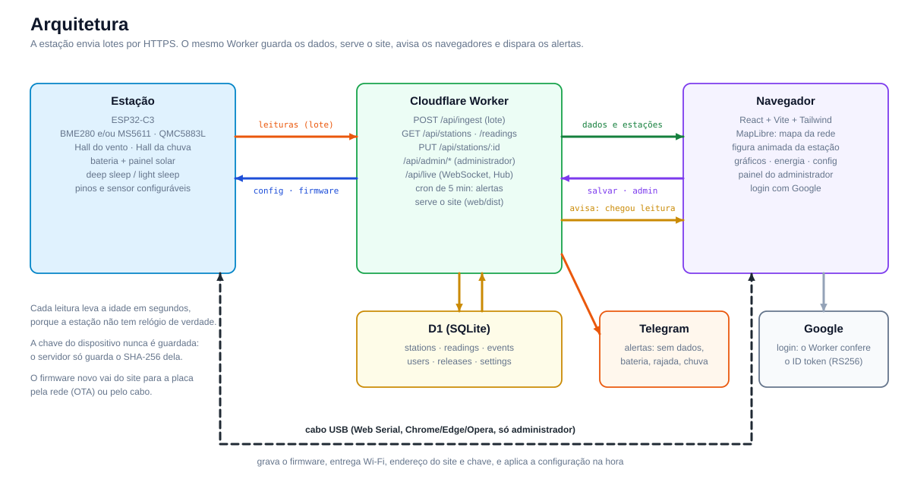
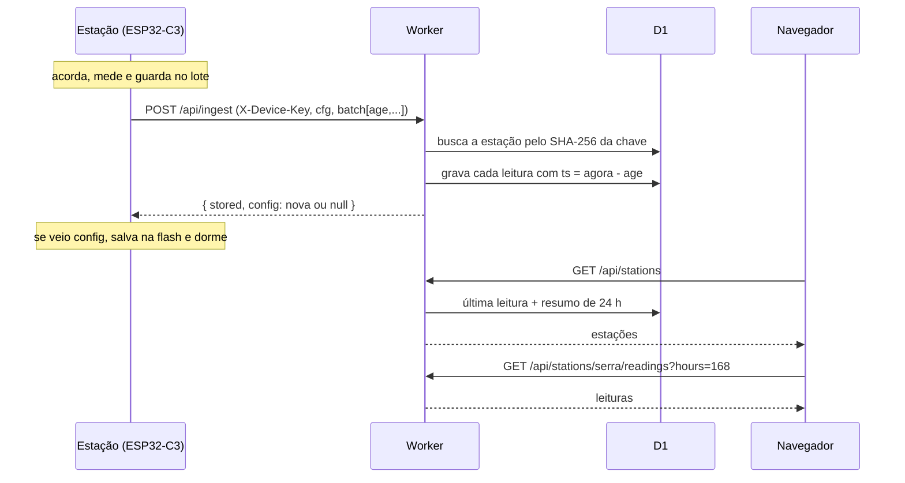
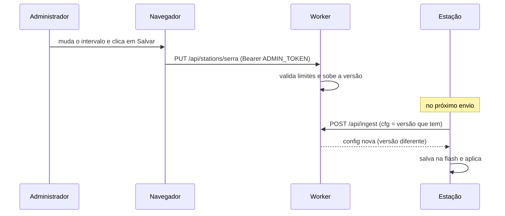

# Arquitetura



## Visão geral

| Parte | Tecnologia | Papel |
|---|---|---|
| **Estação** | ESP32-C3, PlatformIO (Arduino) | Mede, guarda um lote, envia por HTTPS, baixa a configuração, dorme. |
| **API + site** | Cloudflare Worker + D1 (SQLite) | Recebe leituras, guarda, entrega dados, serve o site, guarda a configuração. |
| **Site** | React, Vite, Tailwind v4, motion, Lenis, MapLibre | Mapa da rede, página da estação, gráficos, energia e configuração. |

Tudo o que o site mostra vem das leituras: não há valores inventados em produção. O **modo demonstração** (sem API) existe só para desenvolvimento e é sinalizado na barra superior.

## Fluxo de uma leitura



## Fluxo de configuração



## Decisões

- **Servidor carimba o tempo.** A estação não tem relógio real. Cada leitura vai com a idade em segundos (`age`), e o servidor calcula `agora - age`. Isso permite enviar em lote sem NTP, que gastaria Wi-Fi extra.
- **Lote para economizar.** O Wi-Fi é o maior gasto de energia. Medir a cada 10 min e enviar a cada 30 reduz o consumo médio de ≈ 0,52 para ≈ 0,20 mA (estimativa).
- **Configuração baixada, não empurrada.** A estação dorme, então ela pergunta a cada envio se há versão nova. Não precisa de conexão aberta.
- **Chave por estação, guardada como hash.** Vazou uma? Gera outra sem mexer nas demais. O banco nunca tem chaves em claro.
- **Um Worker só.** O mesmo Worker serve o site (`web/dist`) e a API, sem CORS e com um único deploy.
- **Banco simples.** Duas tabelas (`stations`, `readings`). O vento fica em m/s e o site converte para km/h.
- **Campo de vento do mapa.** As partículas usam ponderação inversa da distância entre as estações online. É uma **estimativa visual**, e não um modelo meteorológico.

## Mapa do código

```
estacao-meteo/
├── firmware/            ESP32-C3 (PlatformIO)
│   └── src/             main, wind, sensors, net, settings, config
├── worker/              Cloudflare Worker + D1
│   ├── src/index.ts     API
│   ├── schema.sql       tabelas
│   └── scripts/         seed.mjs (dados de exemplo) e smoke.mjs (testes)
├── web/                 Site (React)
│   └── src/
│       ├── components/  MapView, MapPage, StationFigure, Energy, ConfigPanel...
│       ├── hooks/       useNetwork, useRoute, useLenis
│       └── lib/         api, derive (cálculos), energy (modelo de consumo), battery
├── adaptacao_sensores_v2/   CAD do anemômetro e da biruta
└── docs/                documentação e diagramas
```
