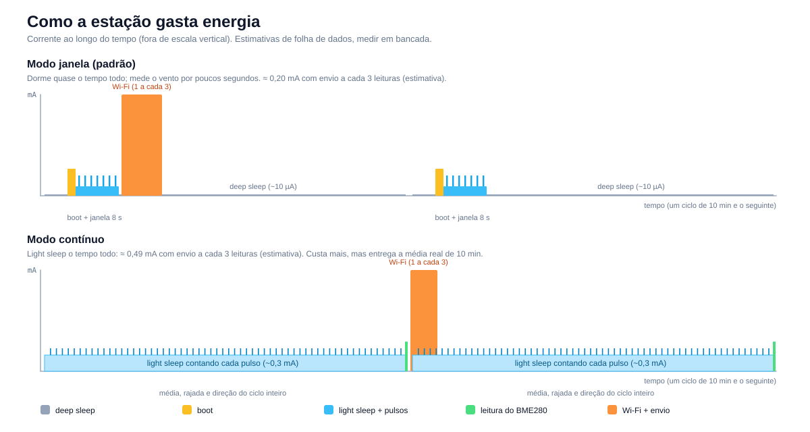

# Energia

A bateria dura muito mais ou muito menos conforme **como** a estação mede e envia. Esta página explica as escolhas e o que esperar. Todos os números são **estimativas de folha de dados**. Meça na sua placa antes de contar com elas.

## De onde vem o consumo

| Fase | Tempo | Corrente (estimada) | Energia por ciclo |
|---|---|---|---|
| Deep sleep | quase todo o intervalo | ~12 µA | desprezível |
| Boot | 0,4 s | 35 mA | 14 mA·s |
| Leitura do BME280 | ~0,3 s | 6 mA | 2 mA·s |
| Janela de vento (light sleep + pulsos) | 8 s | ~0,33 mA | 2,6 mA·s |
| Wi-Fi com HTTPS | 2,6 s | 110 mA (picos de ~350 mA) | **286 mA·s** |

**O Wi-Fi domina.** Por isso a estação envia **em lote**: mede a cada 10 min, guarda na memória e conecta só a cada N leituras. O firmware já reconecta rápido (canal, BSSID e IP guardados na RTC, sem varredura nem DHCP).

## Os dois modos de vento

### Modo janela (padrão)

A cada intervalo o chip acorda, conta pulsos do anemômetro por poucos segundos em **light sleep** (a CPU só acorda a cada pulso), lê o BME280, guarda a leitura e volta ao deep sleep.

- Consumo médio: **≈ 0,20 mA** com envio a cada 3 leituras e **≈ 0,52 mA** com envio a cada leitura.
- Limite: a velocidade e a rajada vêm de uma amostra curta (8 s) de um período de 10 min. É uma **amostra**, e não a média do período.
- A chuva acorda o chip por GPIO a cada basculada, e continua certa.

### Modo contínuo

Fica em light sleep o ciclo inteiro, conta cada pulso e, no fim do intervalo, entrega **média, rajada e direção do período todo**. É assim que os equipamentos profissionais fazem (a OMM usa média de 10 min e rajada de 3 s).

- Consumo médio: **≈ 0,49 mA** com envio a cada 3 leituras (mais que o modo janela, mas com o dado certo).
- **Exige Hall de baixa corrente** (DRV5032 ou reed). Com o A3144 (4,4 mA parado) a bateria acaba em dias.
- Ligue em *Configuração → Contar o vento o tempo todo*. A estação reinicia sozinha ao receber a mudança.

## Autonomia estimada (bateria de 3000 mAh, sem sol)

| Perfil | Consumo médio | Autonomia aproximada |
|---|---|---|
| Janela, envio a cada leitura | ≈ 0,52 mA | ~190 dias |
| **Janela, envio a cada 3 leituras (padrão)** | ≈ 0,20 mA | ~500 dias, na teoria |
| Contínuo, envio a cada 3 leituras | ≈ 0,49 mA | ~205 dias |
| Contínuo, envio a cada leitura | ≈ 0,80 mA | ~125 dias |
| Janela, com ESP-NOW e gateway (ideia futura) | ≈ 0,05 a 0,1 mA | > 1 ano |

Calculado com 80% da capacidade nominal. Nos perfis de menor consumo a **autodescarga da bateria** (algo como 2% ao mês) e o frio passam a pesar mais que o chip, e o painel solar vale a pena. O site calcula a autonomia ao vivo conforme você mexe na configuração (página *Configurações* da estação).

## Botões de economia no site

| Opção | Efeito |
|---|---|
| **Intervalo entre envios** | Menos leituras por hora. |
| **Enviar a cada N leituras** | Menos conexões Wi-Fi. É a maior economia. |
| **Enviar na hora se a rajada passar de X km/h** | Mantém o lote longo sem perder o aviso de vento forte. |
| **Economizar abaixo de X V** | Abaixo dessa tensão o intervalo é multiplicado. |
| **Hibernar abaixo de X V** | Abaixo dessa tensão a estação só dorme por 1 h, para proteger a célula. |

| **Carregando acima de X V** | Com painel solar, a tensão alta indica carga. A estação usa o intervalo curto (`charge_interval_min`) enquanto há energia sobrando. 0 desliga. |
| **Modo bancada (minutos)** | Wi-Fi ligado por esse tempo a cada boot a frio. Em campo, 0. |

Ao trocar a química da bateria, os dois limites de tensão recebem valores sugeridos para ela. A passagem entre normal, lento e hibernação tem histerese de 0,05 V, para não alternar quando a tensão oscila no limite.

Uma atualização de firmware pelo ar baixa até 1,6 MB com o Wi-Fi ligado: conta como alguns envios de uma vez. A estação adia a atualização se a bateria estiver baixa.

## O que mais gasta sem você perceber

- **Placa de desenvolvimento:** LED e regulador podem consumir centenas de µA o tempo todo.
- **A3144 alimentado direto:** 4,4 mA parado.
- **Divisor da bateria de 10 kΩ:** 200 µA. Use 1 MΩ.
- **Pull-up de 10 kΩ no Hall:** gasta 330 µA enquanto o ímã estiver perto. Com DRV5032 use 1 MΩ.
- **Cabo USB num computador:** a placa não dorme enquanto ele estiver ali (para a porta continuar disponível). Em campo, sem cabo ou só com carregador, ela segue o ciclo de baixo consumo.

## Como medir de verdade

1. Use um multímetro de µA, ou um medidor tipo Power Profiler, em série com a bateria.
2. Meça o deep sleep (alvo ≤ 20 µA), depois o light sleep com o rotor parado e girando, depois um envio completo.
3. Atualize as constantes em [web/src/lib/energy.ts](../web/src/lib/energy.ts) para o site calcular a autonomia com os seus números.

## Ideias para economizar ainda mais

Estas não estão implementadas, mas são viáveis:

- **ESP-NOW para um gateway:** um segundo ESP32 ligado na tomada recebe o pacote em poucos ms e repassa ao servidor. Troca 290 mA·s do Wi-Fi por alguns mA·s.
- **ESP32-C6 com núcleo auxiliar (LP core):** conta pulsos em deep sleep. Exige ESP-IDF.
- **Cache de sessão TLS** ou envio por HTTP simples para um gateway local.
