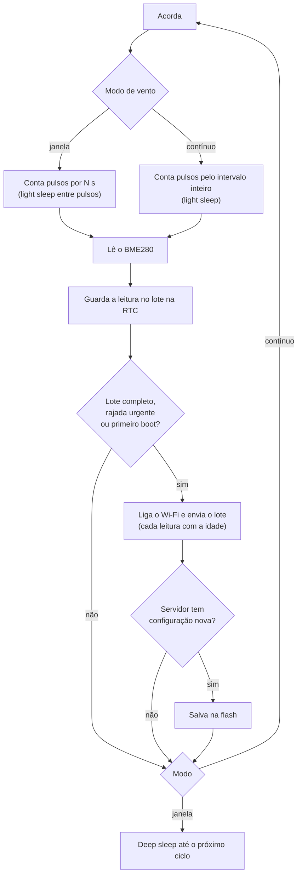

# Firmware

Firmware do ESP32-C3 em PlatformIO (Arduino). Mede, guarda um lote, envia por HTTPS, baixa a configuração e dorme.

## Compilar e gravar

```bash
cd firmware
pio run -e esp32c3 -t upload      # desenvolvimento (USB serial ativa)
pio device monitor                # log e calibração
pio run -e esp32c3-lowpower -t upload   # estação em campo
```

| Ambiente | USB CDC | Quando usar |
|---|---|---|
| `esp32c3` | ligada | Bancada: log, calibração da biruta. |
| `esp32c3-lowpower` | desligada | Campo: o USB CDC atrapalha o light sleep. |

Instale o PlatformIO com `pip install platformio` ou pela extensão do VS Code.

## Primeiro uso

1. Grave o firmware e ligue a estação.
2. Sem rede salva, ela cria a rede **EstacaoMeteo-XXXX**. Conecte pelo celular.
3. Escolha o Wi-Fi e a senha, o **endereço do site** (`https://...workers.dev`) e a **chave do dispositivo** (mostrada ao criar a estação no site).
4. Salve. A estação mede, envia a primeira leitura e passa a seguir a rotina.

Para reabrir o portal: segure o botão **BOOT** (GPIO9) ao ligar.

## Como funciona um ciclo



- **Chuva:** em modo janela cada basculada acorda o chip do deep sleep por GPIO, soma na memória RTC e volta a dormir. Em modo contínuo é contada no próprio light sleep. O valor só é zerado depois que vira leitura.
- **Falha de Wi-Fi:** as leituras ficam no lote (até 12) e vão no próximo envio. Se o lote enche, a mais antiga é descartada e a chuva dela é somada na seguinte, então nada de chuva se perde.
- **Bateria baixa:** abaixo de *Economizar abaixo de* o intervalo é multiplicado. Abaixo de *Hibernar abaixo de*, dorme 1 h.
- **BME280 sem resposta:** a leitura do ciclo é descartada (o servidor exige todos os campos).

## Medição

| Grandeza | Como é medida |
|---|---|
| **Velocidade média** | `kWind × (pulsos ÷ segundos)`. O fator é calibrado no site. |
| **Rajada** | Maior média de `gust_window_s` segundos (padrão 3 s) dentro do período. |
| **Direção** | QMC5883L amostrado 4 vezes por segundo (janelas curtas) ou 1 vez por segundo (longas). **Média vetorial** de vetores unitários, para que 350° e 10° deem 0°, e não 180°. É a direção **de onde o vento vem**. |
| **Temperatura, umidade, pressão** | BME280 em modo forçado, média de `samples` leituras. |
| **Chuva** | Basculadas × `mm_per_tip`. |
| **Bateria** | ADC com média de 16 leituras, vezes `VBAT_DIV`. |

## Configuração remota

O ESP32 manda a versão da configuração que tem (`cfg`). Se o servidor tiver uma mais nova, devolve a nova e o ESP32 salva na flash. Edite pela aba *Configuração* da estação no site.

| Campo | Padrão | O que faz |
|---|---|---|
| `interval_min` | 10 | Intervalo entre leituras. |
| `wind_window_s` | 8 | Tempo de contagem no modo janela. |
| `gust_window_s` | 3 | Tamanho da janela da rajada. |
| `samples` | 8 | Amostras do BME280 por leitura. |
| `send_every` | 3 | Envia a cada N leituras (1 a 12). |
| `urgent_gust_kmh` | 0 | Envia na hora se a rajada passar disso (0 desliga). |
| `continuous_wind` | 0 | 1 = modo contínuo. |
| `wifi_timeout_s` | 10 | Tempo máximo para conectar. |
| `mm_per_tip` | 0,2 | Chuva por basculada. |
| `k_wind` | 0,42 | m/s por volta/s do anemômetro. |
| `dir_offset` | 0 | Graus lidos com a biruta apontando para o norte. |
| `slow_below_v` / `slow_factor` | 3,55 V / 3 | Economia com bateria baixa. |
| `critical_v` | 3,20 V | Hibernação. |

## Calibração pela porta serial

Ao ligar (boot a frio), o monitor serial espera 6 s por uma tecla:

- **`c`**: calibra a biruta. Gire-a 360° devagar, duas vezes, em 20 s. O firmware guarda centro e escala do campo magnético (compensação simples de hard e soft iron).
- **`n`**: com a biruta apontada para o **norte**, mostra o número a digitar em *Ajuste do norte da biruta* no site.

Se a direção girar ao contrário, troque `DIR_SIGN` para `-1` em [config.h](../firmware/src/config.h). Passo a passo completo em [calibracao.md](calibracao.md).

## Estrutura do código

| Arquivo | Função |
|---|---|
| [`main.cpp`](../firmware/src/main.cpp) | Ciclos (janela e contínuo), lote de leituras, decisão de enviar. |
| [`wind.cpp`](../firmware/src/wind.cpp) | Contagem de pulsos em light sleep, rajada, direção vetorial, chuva. |
| [`sensors.cpp`](../firmware/src/sensors.cpp) | BME280, QMC5883L, bateria, calibração serial. |
| [`net.cpp`](../firmware/src/net.cpp) | Wi-Fi rápido, portal cativo, envio do lote. |
| [`settings.cpp`](../firmware/src/settings.cpp) | Configuração e rede guardadas na flash. |
| [`config.h`](../firmware/src/config.h) | Pinos, limites e padrões. |

## Segurança

- O HTTPS **não valida o certificado por padrão** (`setInsecure`). Para validar, cole o certificado raiz do seu servidor em `ROOT_CA_PEM` em [net.cpp](../firmware/src/net.cpp).
- A chave do dispositivo só autoriza **enviar leituras**. Não dá acesso à configuração nem às outras estações.
- A senha do Wi-Fi e a chave ficam na flash, sem criptografia.

## Limites conhecidos

- **Não foi validado em hardware.** O código compila e a lógica foi revisada, mas o light sleep com wake por GPIO depende do comportamento real do chip e do Hall.
- O wake por GPIO no light sleep é por **nível**, então cada pulso acorda duas vezes (descida e subida). Em ventos muito fortes o consumo sobe.
- O relógio não tem hora real: as leituras vão com a idade em segundos e o servidor carimba. Se a estação perder energia, as leituras guardadas na RTC se perdem.
