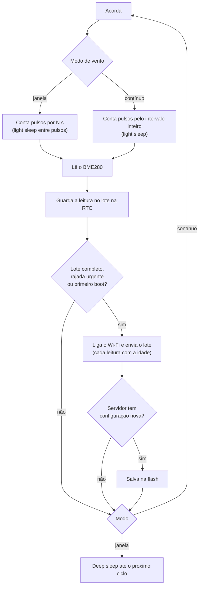

# Firmware

Firmware do ESP32-C3 em PlatformIO (Arduino). Mede, guarda um lote, envia por HTTPS, baixa a configuração e dorme.

## Compilar e gravar

```bash
cd firmware
pio run -e esp32c3 -t upload      # desenvolvimento (USB serial ativa)
pio device monitor                # log e calibração
pio run -e esp32c3-lowpower -t upload   # estação em campo
```

| Ambiente | USB CDC | Quando usar |
|---|---|---|
| `esp32c3` | ligada | Bancada: log, calibração da biruta. |
| `esp32c3-lowpower` | desligada | Campo: o USB CDC atrapalha o light sleep. |

Instale o PlatformIO com `pip install platformio` ou pela extensão do VS Code.

## Primeiro uso

1. Grave o firmware e ligue a estação.
2. Sem rede salva, ela cria a rede **EstacaoMeteo-XXXX**. Conecte pelo celular.
3. Escolha o Wi-Fi e a senha, o **endereço do site** (`https://...workers.dev`) e a **chave do dispositivo** (mostrada ao criar a estação no site).
4. Salve. A estação mede, envia a primeira leitura e passa a seguir a rotina.

Para reabrir o portal: segure o botão **BOOT** (GPIO9) ao ligar.

## Como funciona um ciclo



- **Chuva:** em modo janela cada basculada acorda o chip do deep sleep por GPIO, soma na memória RTC e volta a dormir. Em modo contínuo é contada no próprio light sleep. O valor só é zerado depois que vira leitura.
- **Falha de Wi-Fi:** as leituras ficam no lote (até 12) e vão no próximo envio. Se o lote enche, a mais antiga é descartada e a chuva dela é somada na seguinte, então nada de chuva se perde.
- **Bateria baixa:** abaixo de *Economizar abaixo de* o intervalo é multiplicado. Abaixo de *Hibernar abaixo de*, dorme 1 h.
- **BME280 sem resposta:** a leitura do ciclo é descartada (o servidor exige todos os campos).

## Medição

| Grandeza | Como é medida |
|---|---|
| **Velocidade média** | `kWind × (pulsos ÷ segundos)`. O fator é calibrado no site. |
| **Rajada** | Maior média de `gust_window_s` segundos (padrão 3 s) dentro do período. |
| **Direção** | QMC5883L amostrado 4 vezes por segundo (janelas curtas) ou 1 vez por segundo (longas). **Média vetorial** de vetores unitários, para que 350° e 10° deem 0°, e não 180°. É a direção **de onde o vento vem**. |
| **Temperatura, umidade, pressão** | BME280 em modo forçado, média de `samples` leituras. |
| **Chuva** | Basculadas × `mm_per_tip`. |
| **Bateria** | ADC com média de 16 leituras, vezes `VBAT_DIV`. |

## Configuração remota

O ESP32 manda a versão da configuração que tem (`cfg`). Se o servidor tiver uma mais nova, devolve a nova e o ESP32 salva na flash. Edite em *Configurações* da estação, no site (`#/s/<id>/config`).

| Campo | Padrão | O que faz |
|---|---|---|
| `interval_min` | 10 | Intervalo entre leituras. |
| `wind_window_s` | 8 | Tempo de contagem no modo janela. |
| `gust_window_s` | 3 | Tamanho da janela da rajada. |
| `samples` | 8 | Amostras do BME280 por leitura. |
| `send_every` | 3 | Envia a cada N leituras (1 a 12). |
| `urgent_gust_kmh` | 0 | Envia na hora se a rajada passar disso (0 desliga). |
| `continuous_wind` | 0 | 1 = modo contínuo. |
| `wifi_timeout_s` | 10 | Tempo máximo para conectar. |
| `mm_per_tip` | 0,2 | Chuva por basculada. |
| `k_wind` | 0,42 | m/s por volta/s do anemômetro. |
| `dir_offset` | 0 | Graus lidos com a biruta apontando para o norte. |
| `slow_below_v` / `slow_factor` | 3,55 V / 3 | Economia com bateria baixa. |
| `critical_v` | 3,20 V | Hibernação. |
| `charge_above_v` / `charge_interval_min` | 0 (desligado) / 5 | Acima dessa tensão a estação entende que está **carregando** (sol no painel) e usa o intervalo curto. |
| `bench_min` | 2 | Minutos do modo bancada ao ligar (0 desliga, máximo 30). |

A tensão da bateria usa **histerese** de 0,05 V: a estação só passa para o modo lento (ou volta) depois de cruzar o limite por essa folga, para não ficar alternando quando a leitura oscila no limite.

Depois de baixar uma configuração nova, a estação a aplica e, no envio seguinte, informa a versão que tem. O site troca **pendente** por **aplicada** nessa hora.

## Gravar o firmware pelo navegador

Sem PlatformIO e sem instalar nada: o site grava o firmware numa placa pelo cabo USB (Chrome, Edge ou Opera, via Web Serial e [esptool-js](https://github.com/espressif/esptool-js)).

1. Gere as imagens de fábrica, com o endereço do seu site embutido (precisa do PlatformIO, uma vez):

   ```bash
   cd firmware
   python tools/make_factory.py --server https://seu-site.workers.dev
   ```

   Isso compila os dois ambientes e escreve `estacao-c3-campo.bin` (baixo consumo), `estacao-c3-usb.bin` (com USB serial) e um `manifest.json` em `web/public/firmware/`. Essas imagens não vão para o git. Rode `npm run build` e publique o site.
2. No site, **Ajustes → Gravar firmware**: escolha a placa, a imagem e toque em *Gravar*. Também dá para usar um `.bin` seu (imagem completa em 0x0, ou só o aplicativo em 0x10000).
3. Terminada a gravação, a placa reinicia e é reconhecida sozinha (veja abaixo) ou segue para o pareamento por código.

**Em desenvolvimento** (sem site publicado): use o IP do seu computador na rede, por exemplo `--server http://192.168.1.2:8787`, e suba a API aberta para a rede com `npm run dev:lan` (na pasta `worker`). O endereço `http://` põe a placa em modo assinado, que precisa do ID da estação; o **código de pareamento não funciona** (exige `https://`), então configure a placa pela USB (o site reconhece e grava Wi-Fi, endereço, ID e chave). O firewall do Windows pode pedir permissão para o Node/workerd na rede privada.

A USB nativa do ESP32-C3 entra em modo de gravação sozinha. Com uma ponte CH340 ou CP210x pode ser preciso segurar BOOT, apertar RESET e soltar. *Apagar toda a flash* remove Wi-Fi, chave e calibração salvos.

## Instalar sem computador: código de pareamento

1. Grave a placa uma vez, por cabo, com o endereço do seu site embutido (veja *Gravar o firmware pelo navegador*; o portal deixa de pedi-lo). Envie já gravada para quem vai instalar.
2. No site, **Adicionar estação** (ou, numa estação existente, *Configurações → Gerar código de pareamento*). O site mostra um código como `K7F-29Q` e um texto pronto para mandar a quem instala.
3. Quem instala liga a placa, conecta o celular em `EstacaoMeteo-XXXX`, escolhe a rede do local e digita o código. Pronto.
4. Assim que conecta ao Wi-Fi, a placa troca o código pela chave (`POST /api/claim`) e passa a enviar. Se faltar internet naquele momento, ela guarda o código e tenta de novo nos próximos ciclos. Se o código estiver errado ou vencido, ela o descarta: gere outro e refaça o portal (segure BOOT ao ligar).

O pareamento só funciona com o endereço em `https://`, porque a chave viaja na resposta. Os campos *ID* e *chave* do portal continuam existindo como alternativa manual.

## Reconhecimento pela USB (Web Serial)

Com o site aberto no Chrome, Edge ou Opera, a placa plugada é reconhecida sozinha: o site mostra um aviso, diz qual estação ela é e oferece **configurar Wi-Fi, endereço e chave** sem o portal. Na primeira vez, autorize a placa em *Ajustes → Placa USB* (o navegador exige um clique); depois ela é reconhecida a cada plugada.

Como funciona: no boot a frio, o firmware escuta a USB por 10 s (cada comando renova a janela) e responde a comandos em JSON, uma linha por comando (`hello`, `provision`, `restart`, em [usblink.cpp](../firmware/src/usblink.cpp)). Ao configurar, o site **gera uma chave nova** para a estação, entrega direto à placa e ela reinicia. Se a placa não responder, o site tenta reiniciá-la pelos sinais DTR/RTS.

Limites: só no ambiente `esp32c3` (o `lowpower` não tem USB serial, e a placa aparece como "firmware não respondeu"); o site precisa estar em `https://` ou `localhost`; e a placa não alcança `localhost`, então o endereço gravado deve ser o publicado ou o IP do computador.

## Modo bancada (sem cabo serial)

Ao ligar a estação (boot a frio) com Wi-Fi já salvo, ela abre por `bench_min` minutos uma página local, em `http://estacao-xxxx.local` ou no IP que aparece no log. A página mostra as leituras ao vivo e tem botões para **calibrar a biruta** e **mostrar o ângulo do norte**, sem monitor serial. A página não tem senha: qualquer um na sua rede enquanto ela estiver aberta pode vê-la, por isso ela é curta. O botão *Terminar* encerra antes. Depois a estação segue a rotina normal. Segurar o botão BOOT ao ligar pula o modo bancada e abre o portal Wi-Fi.

O modo bancada gasta bateria (Wi-Fi ligado). Em campo, ponha `bench_min` em 0.

## Calibração pela porta serial

Ao ligar (boot a frio), o monitor serial espera 6 s por uma tecla:

- **`c`**: calibra a biruta. Gire-a 360° devagar, duas vezes, em 20 s. O firmware guarda centro e escala do campo magnético (compensação simples de hard e soft iron).
- **`n`**: com a biruta apontada para o **norte**, mostra o número a digitar em *Ajuste do norte da biruta* no site.

Se a direção girar ao contrário, troque `DIR_SIGN` para `-1` em [config.h](../firmware/src/config.h). Passo a passo completo em [calibracao.md](calibracao.md).

## Estrutura do código

| Arquivo | Função |
|---|---|
| [`main.cpp`](../firmware/src/main.cpp) | Ciclos (janela e contínuo), lote de leituras, decisão de enviar. |
| [`wind.cpp`](../firmware/src/wind.cpp) | Contagem de pulsos em light sleep, rajada, direção vetorial, chuva. |
| [`sensors.cpp`](../firmware/src/sensors.cpp) | BME280, QMC5883L, bateria, calibração serial. |
| [`net.cpp`](../firmware/src/net.cpp) | Wi-Fi rápido, portal cativo, envio do lote (HTTPS ou HTTP assinado). |
| [`auth.cpp`](../firmware/src/auth.cpp) | HMAC-SHA256 (mbedtls) dos pedidos e conferência da resposta do servidor. |
| [`ota.cpp`](../firmware/src/ota.cpp) | Atualização pelo ar com conferência de tamanho e SHA-256. |
| [`bench.cpp`](../firmware/src/bench.cpp) | Página local do modo bancada. |
| [`events.cpp`](../firmware/src/events.cpp) | Registro de reinícios e atualizações na RTC, enviado com o lote. |
| [`settings.cpp`](../firmware/src/settings.cpp) | Configuração e rede guardadas na flash. |
| [`config.h`](../firmware/src/config.h) | Pinos, limites e padrões. |

## Diagnóstico

Quando o motivo do reinício **não** é o acordar normal do deep sleep (queda de energia, travamento, watchdog), a estação guarda um evento `boot` com o motivo e um contador, e o manda no próximo envio. O site mostra em *Configurações → Diagnóstico*, junto com atualizações e modo bancada. Reinícios repetidos com a tensão caindo apontam para a bateria ou o regulador.

## Atualização pelo ar (OTA)

Gere o binário (`pio run -e esp32c3-lowpower`, arquivo `.pio/build/esp32c3-lowpower/firmware.bin`), mude `FW_VERSION` em [config.h](../firmware/src/config.h) **antes** de compilar e publique em *Configurações → Firmware pelo ar*. A estação:

1. envia as leituras; só se der certo, olha se há firmware publicado com versão **diferente** da dela;
2. adia se a bateria estiver baixa e desiste da versão depois de 3 falhas;
3. baixa, confere tamanho e SHA-256 e só então grava e reinicia.

**Não há reversão automática**: se o firmware novo travar ao iniciar, a estação precisa de cabo. Teste antes numa estação de bancada. Em HTTP assinado, a oferta de atualização vem numa resposta assinada, então ninguém na rede consegue empurrar um firmware falso.

## Envio por HTTP assinado

Se o endereço do site no portal começar com `http://`, a estação não manda a chave: assina cada pedido com HMAC-SHA256 (veja [api.md](api.md#estação-por-http-assinado)) e confere a assinatura da resposta antes de aplicar configuração ou firmware. Precisa do **ID da estação** no portal. Gasta menos energia que o TLS, mas o conteúdo das leituras fica legível na rede. Não vale para dados sensíveis.

## Segurança

- O HTTPS **não valida o certificado por padrão** (`setInsecure`). Para validar, cole o certificado raiz do seu servidor em `ROOT_CA_PEM` em [net.cpp](../firmware/src/net.cpp).
- A chave do dispositivo só autoriza **enviar leituras**. Não dá acesso à configuração nem às outras estações.
- A senha do Wi-Fi e a chave ficam na flash, sem criptografia.

## Limites conhecidos

- **Não foi validado em hardware.** O código compila e a lógica foi revisada, mas o light sleep com wake por GPIO depende do comportamento real do chip e do Hall.
- O wake por GPIO no light sleep é por **nível**, então cada pulso acorda duas vezes (descida e subida). Em ventos muito fortes o consumo sobe.
- O relógio não tem hora real: as leituras vão com a idade em segundos e o servidor carimba. Se a estação perder energia, as leituras guardadas na RTC se perdem.
