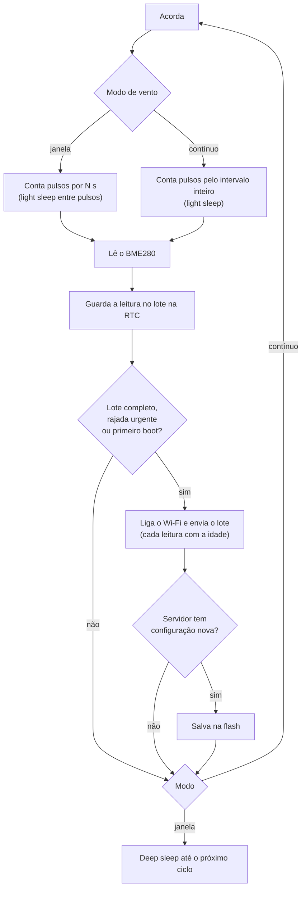

# Firmware

Firmware do ESP32-C3 em PlatformIO (Arduino). Mede, guarda um lote, envia por HTTPS, baixa a configuração e dorme.

## Compilar e gravar

```bash
cd firmware
pio run -t upload                 # compila e grava pelo cabo USB
pio device monitor                # log e calibração da biruta
```

Há **um só firmware** (ambiente `esp32c3`), igual para a bancada e para o campo. A porta USB nativa do ESP32-C3 só é aberta quando há um computador do outro lado do cabo:

| Situação | O que a placa faz |
|---|---|
| **Sem cabo**, ou cabo só de carga (bateria, painel solar, carregador) | Ciclo de baixo consumo: mede, envia, dorme. A USB não é aberta e não custa nada. |
| **Cabo num computador** | Ao ligar, atende o site por alguns segundos (configura Wi-Fi, endereço e chave) e aceita `c`/`n` no monitor serial. Depois **não dorme** enquanto o cabo estiver ali, para a porta continuar disponível para gravar. Mede normalmente, sem light sleep. |

Por isso gravar uma placa que está no computador funciona a qualquer hora, sem apertar RESET nem BOOT. Uma placa **sem cabo** dorme entre as leituras e a porta some do computador: para gravá-la, plugue o cabo e aperte RESET (ela acorda e fica acordada).

O `platformio.ini` escolhe sozinho a porta da placa (`tools/pick_port.py`). O PlatformIO às vezes escolhia uma COM de Bluetooth do Windows e a gravação falhava com "port doesn't exist". Para forçar outra porta: `pio run -t upload --upload-port COM5`.

Instale o PlatformIO com `pip install platformio` ou pela extensão do VS Code.

## Primeiro uso

1. Grave o firmware e ligue a estação.
2. Sem rede salva, ela cria a rede **EstacaoMeteo-XXXX**. Conecte pelo celular.
3. Escolha o Wi-Fi e a senha, o **endereço do site** (`https://...workers.dev`) e a **chave do dispositivo** (mostrada ao criar a estação no site).
4. Salve. A estação mede, envia a primeira leitura e passa a seguir a rotina.

Para reabrir o portal: ligue a placa e, **nos primeiros 6 segundos**, aperte o botão **BOOT** (GPIO9) por meio segundo. **Não segure o BOOT ao ligar**: com o GPIO9 em nível baixo no reset o ESP32-C3 entra em modo de gravação e o firmware nem executa (foi o motivo de o portal "não abrir" nas versões antigas). Com o cabo num computador o portal não abre sozinho (a configuração é pelo site, pela USB); para usá-lo mesmo assim, aperte BOOT nessa janela, ou mande `{"cmd":"portal"}` pela USB.

## Como funciona um ciclo



- **Chuva:** em modo janela cada basculada acorda o chip do deep sleep por GPIO, soma na memória RTC e volta a dormir. Em modo contínuo é contada no próprio light sleep. O valor só é zerado depois que vira leitura.
- **Falha de Wi-Fi:** as leituras ficam no lote (até 12) e vão no próximo envio. Depois de **3 falhas seguidas** (e de novo após 9, 27 e 81) a estação abre o portal **EstacaoMeteo-XXXX** por 3 minutos para o celular escolher outra rede: é o caso de levar a estação para outro lugar ou trocar a senha do roteador. Com o cabo no computador o portal não abre (configure pelo site).
- **Reiniciar pelo site:** o administrador pede o reinício; a estação recebe no próximo envio, reinicia e o envio seguinte confirma. Se o lote enche, a mais antiga é descartada e a chuva dela é somada na seguinte, então nada de chuva se perde.
- **Bateria baixa:** abaixo de *Economizar abaixo de* o intervalo é multiplicado. Abaixo de *Hibernar abaixo de*, dorme 1 h.
- **Sensor de ambiente sem resposta:** a leitura do ciclo é descartada (o servidor exige todos os campos). Com *Sensor de ambiente = Nenhum* a placa só manda o sinal de vida (bateria e Wi-Fi).

## Potência do Wi-Fi (`wifi_tx_save`)

O Wi-Fi é o maior consumo da estação. Com `wifi_tx_save` = 1, antes de conectar a estação escolhe a potência de transmissão pelo sinal da **última conexão**:

| Sinal (RSSI) | Potência |
|---|---|
| mais forte que -50 dBm | 8,5 dBm |
| -50 a -60 dBm | 11 dBm |
| -60 a -70 dBm | 15 dBm |
| mais fraco que -70 dBm, ou sem histórico | 19,5 dBm (máxima) |

O RSSI é o que a estação ouve do roteador; o caminho de volta tende a ser parecido, por isso as faixas têm folga. Se a conexão falhar com potência reduzida, a estação tenta de novo na máxima, e só volta a reduzir depois de 6 conexões. A economia estimada no modelo de energia do site é de cerca de 10 % no consumo do Wi-Fi; meça no seu local.

## Sensores e pinos (`env_sensor`, `pin_*`)

Na página da estação, em *Configurações da estação → Placa e sensores*, escolhe-se o sensor de ambiente e os GPIOs. Tudo chega à placa pela configuração remota.

| `env_sensor` | Sensor | Observação |
|---|---|---|
| 0 | nenhum | só o sinal de vida (bateria e Wi-Fi) a cada intervalo |
| 1 | BME280 | 0x76 ou 0x77; temperatura, umidade e pressão |
| 2 | MS5611 (GY-63) | 0x77 (CSB no GND) ou 0x76; temperatura e pressão, **sem umidade** (o site mostra "—") |
| 3 | BME280 + MS5611 | BME280 em 0x76 (temperatura e umidade) e MS5611 em 0x77 (pressão) |

Pinos (`pin_sda`, `pin_scl`, `pin_wind`, `pin_rain`, `pin_vbat`), padrão 6, 7, 4, 3, 0. Regras, iguais no site, no servidor e no firmware: sem repetir pino; GPIO0 a 7, 10, 20 e 21 (ficam de fora 8 e 9 de boot, 11 a 17 da flash, 18 e 19 da USB); o da chuva precisa acordar do deep sleep (0 a 5); o da bateria precisa ser ADC1 (0 a 4). O servidor responde 422 a um conjunto inválido, e o firmware ignora um conjunto inválido. Mudar um pino reinicia a placa ao receber a configuração. A fiação tem de estar igual ao configurado.

## Medição

| Grandeza | Como é medida |
|---|---|
| **Velocidade média** | `kWind × (pulsos ÷ segundos)`. O fator é calibrado no site. |
| **Rajada** | Maior média de `gust_window_s` segundos (padrão 3 s) dentro do período. |
| **Direção** | QMC5883L amostrado 4 vezes por segundo (janelas curtas) ou 1 vez por segundo (longas). **Média vetorial** de vetores unitários, para que 350° e 10° deem 0°, e não 180°. É a direção **de onde o vento vem**. |
| **Temperatura, umidade, pressão** | BME280 em modo forçado, média de `samples` leituras. |
| **Chuva** | Basculadas × `mm_per_tip`. |
| **Bateria** | ADC com média de 16 leituras, vezes `VBAT_DIV`. |

## Configuração remota

O ESP32 manda a versão da configuração que tem (`cfg`). Se o servidor tiver uma mais nova, devolve a nova e o ESP32 salva na flash. Edite em *Configurações* da estação, no site (`#/s/<id>/config`).

| Campo | Padrão | O que faz |
|---|---|---|
| `interval_min` | 10 | Intervalo entre leituras. |
| `wind_window_s` | 8 | Tempo de contagem no modo janela. |
| `gust_window_s` | 3 | Tamanho da janela da rajada. |
| `samples` | 8 | Amostras do BME280 por leitura. |
| `send_every` | 3 | Envia a cada N leituras (1 a 12). |
| `urgent_gust_kmh` | 0 | Envia na hora se a rajada passar disso (0 desliga). |
| `wifi_tx_save` | 0 | 1 = reduz sozinha a potência de transmissão do Wi-Fi quando o sinal é bom (veja abaixo). |
| `continuous_wind` | 0 | 1 = modo contínuo. |
| `wifi_timeout_s` | 10 | Tempo máximo para conectar. |
| `mm_per_tip` | 0,2 | Chuva por basculada. |
| `k_wind` | 0,42 | m/s por volta/s do anemômetro. |
| `dir_offset` | 0 | Graus lidos com a biruta apontando para o norte. |
| `slow_below_v` / `slow_factor` | 3,55 V / 3 | Economia com bateria baixa. |
| `critical_v` | 3,20 V | Hibernação. |
| `charge_above_v` / `charge_interval_min` | 0 (desligado) / 5 | Acima dessa tensão a estação entende que está **carregando** (sol no painel) e usa o intervalo curto. |
| `bench_min` | 2 | Minutos do modo bancada ao ligar (0 desliga, máximo 30). |

A tensão da bateria usa **histerese** de 0,05 V: a estação só passa para o modo lento (ou volta) depois de cruzar o limite por essa folga, para não ficar alternando quando a leitura oscila no limite.

Depois de baixar uma configuração nova, a estação a aplica e, no envio seguinte, informa a versão que tem. O site troca **pendente** por **aplicada** nessa hora.

## Gravar o firmware pelo navegador

Sem PlatformIO e sem instalar nada: o site grava o firmware numa placa pelo cabo USB (Chrome, Edge ou Opera, via Web Serial e [esptool-js](https://github.com/espressif/esptool-js)).

### Qual operação usar?

| Situação | Caminho recomendado | O que muda |
|---|---|---|
| **Placa nova ou em branco** | Administração → Site e placas → assistente **Preparar placa (USB)** | Grava o firmware completo, cria ou escolhe uma estação, configura Wi-Fi e vínculo e confirma a primeira leitura. |
| **Placa já responde e está vinculada** | Aviso **Placa USB detectada** ou configuração da estação | Atualiza Wi-Fi/vínculo ou aplica os ajustes da estação pela USB. Reconfigurar uma estação existente gera uma chave nova e invalida a anterior para todas as placas que a compartilhavam. |
| **Atualizar somente o aplicativo** | Seção avançada **Atualizar ou recuperar o firmware sem configurar a estação** | Escolha um `.bin` somente do aplicativo e grave em `0x10000` para preservar a configuração. Não escolhe estação nem configura Wi-Fi/chave. |
| **Recuperar ou inicializar a placa** | Assistente para a imagem completa ou imagem completa na seção avançada | Grava bootloader, partições e aplicativo em `0x0`. Pode redefinir dados salvos mesmo sem marcar *Apagar toda a flash*. Use o assistente para também configurar a placa. |
| **Atualização normal de placas em campo** | Atualização pelo ar (OTA), seção abaixo | Publica uma versão e a placa compatível baixa e verifica o firmware após enviar dados. Não precisa de USB. |

Use **Apagar toda a flash** somente quando quiser uma redefinição completa: isso remove Wi-Fi, chave, calibração e configuração local. Para atualizar uma placa existente preservando a configuração, grave apenas o aplicativo em `0x10000`; regravar a imagem completa substitui também bootloader e partições, então não conte com os dados locais. Configuração da estação (sensores, pinos, intervalos e energia) é independente do firmware e fica na página da estação.

1. Gere a imagem de fábrica (precisa do PlatformIO, uma vez; repita quando mudar o firmware):

   ```bash
   cd firmware
   python tools/make_factory.py --lan                                  # teste local: embute http://IP-DO-COMPUTADOR:8787
   python tools/make_factory.py --server https://seu-site.workers.dev   # site publicado
   ```

   Isso compila o firmware e escreve `estacao-c3.bin` e `manifest.json` em `web/public/firmware/` (fora do git). O site mostra a versão e a hora em que a imagem foi gerada, para você ver se está desatualizada. Em desenvolvimento (`npm run dev`) a pasta já é servida; para publicar, rode `npm run build`.
2. No site, entre como administrador e abra **Administração → Site e placas → Preparar placa (USB)**. Para uma placa nova, escolha *Nova estação…* ou uma estação cadastrada e informe Wi-Fi, depois toque em *Gravar e deixar a placa pronta*. Para atualizar/reparar apenas o firmware, abra a área avançada e escolha a imagem. Também dá para usar um `.bin` seu (imagem completa em 0x0, ou só o aplicativo em 0x10000).
3. Terminada a gravação, a placa reinicia sozinha e o site a reconhece (veja abaixo).

Se a placa estiver dormindo (a porta não aparece), o site avisa para apertar RESET e recomeça a gravação sozinho quando ela surgir. A USB nativa do ESP32-C3 entra em modo de gravação sozinha; com uma ponte CH340 ou CP210x pode ser preciso segurar BOOT, apertar RESET, soltar o RESET e depois o BOOT. *Apagar toda a flash* remove Wi-Fi, chave e calibração salvos.

**Em desenvolvimento**, o endereço que o site grava na placa é o IP do computador (o `npm run dev` descobre sozinho; é só conferir em *Avançado*). Suba a API aberta para a rede com `npm run dev:lan` (pasta `worker`). O endereço `http://` põe a placa em modo assinado, que precisa do ID da estação; o **código de pareamento não funciona** (exige `https://`), então configure a placa pela USB. O firewall do Windows pode pedir permissão para o Node/workerd na rede privada.

## Instalar sem computador: código de pareamento

1. Grave a placa uma vez, por cabo, com o endereço do seu site embutido (veja *Gravar o firmware pelo navegador*; o portal deixa de pedi-lo). Envie já gravada para quem vai instalar.
2. No site, **Adicionar estação** (ou, numa estação existente, *Configurações → Gerar código de pareamento*). O site mostra um código como `K7F-29Q` e um texto pronto para mandar a quem instala.
3. Quem instala liga a placa, conecta o celular em `EstacaoMeteo-XXXX`, escolhe a rede do local e digita o código. Pronto.
4. Assim que conecta ao Wi-Fi, a placa troca o código pela chave (`POST /api/claim`) e passa a enviar. Se faltar internet naquele momento, ela guarda o código e tenta de novo nos próximos ciclos. Se o código estiver errado ou vencido, ela o descarta: gere outro e refaça o portal (aperte BOOT nos primeiros 6 s depois de ligar).

O pareamento só funciona com o endereço em `https://`, porque a chave viaja na resposta. Os campos *ID* e *chave* do portal continuam existindo como alternativa manual.

## Reconhecimento pela USB (Web Serial)

Com o site aberto no Chrome, Edge ou Opera, a placa plugada é reconhecida sozinha: o site mostra um aviso, diz qual estação ela é e oferece **configurar Wi-Fi, endereço e chave** sem o portal. Na primeira vez, autorize a placa em *Administração → Site e placas → Placa USB* (botão *Autorizar uma placa*) (o navegador exige um clique); depois ela é reconhecida a cada plugada.

Como funciona: ao ligar com o cabo num computador, o firmware escuta a USB por 10 s (60 s se ainda não está configurado; cada comando renova a janela) e responde a comandos em JSON, uma linha por comando (`hello`, `scan`, `provision`, `restart`, em [usblink.cpp](../firmware/src/usblink.cpp)). Ao configurar, o site **gera uma chave nova** para a estação, entrega direto à placa e ela reinicia. Se a placa não responder, o site tenta reiniciá-la pelos sinais DTR/RTS.

- **A porta é de um programa só.** O aviso do site solta a porta quando você troca de janela por alguns segundos (para o PlatformIO ou o monitor serial poderem usá-la) e a retoma quando você volta. Se o site disser que a porta está em uso, feche o monitor serial, a IDE ou a outra aba.
- O site precisa estar em `https://` ou `localhost`, e a placa não alcança `localhost`, então o endereço gravado nela deve ser o publicado ou o IP do computador.


### Comandos de diagnóstico pela USB

Além de `hello`, `scan`, `provision`, `config` e `restart`, a placa entende (uma linha JSON por comando):

| Comando | Para que serve |
|---|---|
| `{"cmd":"diag"}` | Devolve **tudo o que a placa tem guardado** (todos os campos da configuração, inclusive pinos e sensor) e o estado do ciclo: nível de bateria, se está carregando, leituras no lote, falhas seguidas de Wi-Fi, intervalo atual e quanto falta para o próximo ciclo. |
| `{"cmd":"simvbat","v":3.4}` | Simula a tensão da bateria (`v` negativo desliga). Serve para testar economia, hibernação e carga sem uma bateria ligada. Some ao reiniciar. |
| `{"cmd":"portal"}` | Abre o portal Wi-Fi (3 min) como se o BOOT tivesse sido apertado. |
| `{"cmd":"nettest","url":"https://..."}` | Conecta ao Wi-Fi e faz um GET validando o HTTPS, sem mandar dados: diz se a rede e o certificado estão OK. |
| `{"cmd":"body","columns":true}` | Mostra o corpo que o próximo envio levaria (para conferir o formato), sem enviar. |

### Configuração aplicada pelo cabo

Com a placa desta estação ligada ao computador e reconhecida pelo site (painel *Placa USB detectada*), **salvar a configuração a aplica na hora, pelo cabo**: o site manda o comando `{"cmd":"config","config":{...}}` (a mesma configuração que o servidor entregaria no próximo envio) e a placa responde `{"ok":true,"version":N,"restarting":false}`. Sem reiniciar, ela sai da espera, mede e envia já, para o servidor registrar a versão como aplicada. Se a mudança for de pinos ou do modo do vento, a placa reinicia sozinha (`"restarting":true`). Só vale se o `id` da placa for o da estação que está sendo salva; se não houver placa no cabo, a configuração segue pelo servidor, como antes. O firmware precisa ser o 0.4.1 ou mais novo.
## Modo bancada (sem cabo serial)

Ao ligar a estação (boot a frio) com Wi-Fi já salvo, **depois de enviar a primeira leitura**, ela abre por `bench_min` minutos uma página local, em `http://estacao-xxxx.local` ou no IP que aparece no log. A página mostra as leituras ao vivo e tem botões para **calibrar a biruta** e **mostrar o ângulo do norte**, sem monitor serial. A página não tem senha: qualquer um na sua rede enquanto ela estiver aberta pode vê-la, por isso ela é curta. O botão *Terminar* encerra antes. Depois a estação segue a rotina normal. Apertar o botão BOOT nos primeiros 6 s depois de ligar pula o modo bancada e abre o portal Wi-Fi.

O modo bancada gasta bateria (Wi-Fi ligado). Em campo, ponha `bench_min` em 0.

## Calibração pela porta serial

Ao ligar com o cabo no computador (boot a frio), o monitor serial espera 10 s por uma tecla (60 s se a placa ainda não está configurada):

- **`c`**: calibra a biruta. Gire-a 360° devagar, duas vezes, em 20 s. O firmware guarda centro e escala do campo magnético (compensação simples de hard e soft iron).
- **`n`**: com a biruta apontada para o **norte**, mostra o número a digitar em *Ajuste do norte da biruta* no site.

Se a direção girar ao contrário, troque `DIR_SIGN` para `-1` em [config.h](../firmware/src/config.h). Passo a passo completo em [calibracao.md](calibracao.md).

## Estrutura do código

| Arquivo | Função |
|---|---|
| [`main.cpp`](../firmware/src/main.cpp) | Ciclos (janela e contínuo), lote de leituras, decisão de enviar. |
| [`wind.cpp`](../firmware/src/wind.cpp) | Contagem de pulsos em light sleep, rajada, direção vetorial, chuva. |
| [`sensors.cpp`](../firmware/src/sensors.cpp) | BME280, QMC5883L, bateria, calibração serial. |
| [`net.cpp`](../firmware/src/net.cpp) | Wi-Fi rápido, portal cativo, envio do lote em colunas, HTTPS validado com as raízes de `roots.h`. |
| [`auth.cpp`](../firmware/src/auth.cpp) | HMAC-SHA256 (mbedtls) dos pedidos e conferência da resposta do servidor. |
| [`ota.cpp`](../firmware/src/ota.cpp) | Atualização pelo ar com conferência de tamanho e SHA-256. |
| [`usblink.cpp`](../firmware/src/usblink.cpp) | Conversa com o site pela USB (JSON), detecção do computador plugado. |
| [`bench.cpp`](../firmware/src/bench.cpp) | Página local do modo bancada. |
| [`events.cpp`](../firmware/src/events.cpp) | Registro de reinícios e atualizações na RTC, enviado com o lote. |
| [`settings.cpp`](../firmware/src/settings.cpp) | Configuração e rede guardadas na flash. |
| [`config.h`](../firmware/src/config.h) | Pinos, limites e padrões. |
| [`roots.h`](../firmware/src/roots.h) | Autoridades raiz para validar o HTTPS (gerado por `tools/make_roots.py`). |

## Envio dos dados

- **Em colunas (0.5+).** Uma lista por medida em vez de um objeto por leitura: menos bytes, menos tempo de rádio. O servidor confirma com `"fmt": 2` e a estação passa a usar; se recusar, ela volta ao formato antigo. Detalhes em [api.md](api.md#formato-em-colunas-firmware-05).
- **Uma conexão por acordada.** O envio, a confirmação da configuração e a atualização reaproveitam a mesma conexão TLS: o aperto de mão, que é o trecho mais caro, acontece uma vez.
- **HTTPS validado.** O certificado do servidor é conferido com as raízes embutidas em [`roots.h`](../firmware/src/roots.h) (as que a Cloudflare usa; gere de novo com `python tools/make_roots.py cacert.pem`). Se a validação falhar, os envios seguem **assinados** (a chave nunca viaja e a resposta é conferida pela assinatura) e a estação registra o evento `tls`, que aparece no diagnóstico do site.
- **Direção e umidade ausentes.** Sem biruta a direção vai vazia (o site mostra "—"), em vez de repetir a última; o MS5611 manda a umidade vazia.
- **Sinal de vida espaçado (`idle_every`).** Uma estação sem sensor manda bateria e sinal a cada `idle_every` leituras, em vez de a cada leitura, para economizar bateria.

## Diagnóstico

Quando o motivo do reinício **não** é o acordar normal do deep sleep (queda de energia, travamento, watchdog), a estação guarda um evento `boot` com o motivo e um contador, e o manda no próximo envio. O site mostra em *Configurações → Diagnóstico*, junto com atualizações e modo bancada. Reinícios repetidos com a tensão caindo apontam para a bateria ou o regulador.

## Atualização pelo ar (OTA)

Gere o binário (`pio run`, arquivo `firmware/.pio/build/esp32c3/firmware.bin`), mude `FW_VERSION` em [config.h](../firmware/src/config.h) **antes** de compilar e publique em *Administração → Firmware* e atribua a versão às estações (a página da estação mostra só a situação, em *Configurações → Firmware pelo ar*). A estação:

1. envia as leituras; só se der certo, olha se há firmware publicado com versão **diferente** da dela;
2. adia se a bateria estiver baixa e desiste da versão depois de 3 falhas;
3. baixa, confere tamanho e SHA-256 e só então grava e reinicia.

**Não há reversão automática**: se o firmware novo travar ao iniciar, a estação precisa de cabo. Teste antes numa estação de bancada. Em HTTP assinado, a oferta de atualização vem numa resposta assinada, então ninguém na rede consegue empurrar um firmware falso.

## Envio por HTTP assinado

Se o endereço do site no portal começar com `http://`, a estação não manda a chave: assina cada pedido com HMAC-SHA256 (veja [api.md](api.md#estação-por-http-assinado)) e confere a assinatura da resposta antes de aplicar configuração ou firmware. Precisa do **ID da estação** no portal. Gasta menos energia que o TLS, mas o conteúdo das leituras fica legível na rede. Não vale para dados sensíveis.

## Segurança

- O HTTPS **não valida o certificado por padrão** (`setInsecure`). Para validar, cole o certificado raiz do seu servidor em `ROOT_CA_PEM` em [net.cpp](../firmware/src/net.cpp).
- A chave do dispositivo só autoriza **enviar leituras**. Não dá acesso à configuração nem às outras estações.
- A senha do Wi-Fi e a chave ficam na flash, sem criptografia.

## Limites conhecidos

- **Não foi validado em hardware.** O código compila e a lógica foi revisada, mas o light sleep com wake por GPIO depende do comportamento real do chip e do Hall.
- O wake por GPIO no light sleep é por **nível**, então cada pulso acorda duas vezes (descida e subida). Em ventos muito fortes o consumo sobe.
- O relógio não tem hora real: as leituras vão com a idade em segundos e o servidor carimba. Se a estação perder energia, as leituras guardadas na RTC se perdem.
