# Guia: colocar uma estação nova no ar

Passo a passo para quem tem um **ESP32-C3 novo** e quer vê-lo enviando dados no site. Não precisa instalar nada no computador além do navegador. Se você já montou a parte física (sensores, bateria), este guia leva da placa "em branco" até a primeira leitura no mapa.

> As telas abaixo são do site rodando em modo de desenvolvimento, com as estações de exemplo e a conta de administrador de desenvolvimento (**Entrar sem senha**). As telas do aviso "Placa USB detectada" (passo 3) foram tiradas com uma placa simulada e de uma versão anterior do mapa, mas o texto e os botões do aviso são os atuais.

**Tempo estimado:** 10 a 15 minutos, mais o tempo de gravar o firmware.

---

## 0. Antes de começar

Separe estas coisas. A maioria dos problemas vem de faltar uma delas.

| O que | Por quê |
|---|---|
| **Navegador Chrome, Edge ou Opera** no computador | Só eles falam com a placa pela USB (Web Serial). Firefox e Safari não servem. |
| **Cabo USB de dados** | Muitos cabos só carregam e não transmitem dados. Se o computador não "enxerga" a placa, troque o cabo. |
| **Rede Wi-Fi de 2,4 GHz**, o nome e a senha | O ESP32-C3 **não conecta em 5 GHz**. Se o seu roteador junta as duas redes no mesmo nome, crie uma rede 2,4 GHz separada para teste. |
| **Conta de administrador** | Só o administrador cadastra estações, grava placas e publica firmware. Em produção é o login com o Google de um e-mail listado em `ADMIN_EMAILS`. No seu computador, em desenvolvimento, é o botão **Entrar sem senha**. Veja a seção abaixo. |
| **O site no ar** e **alcançável pela placa** | A placa precisa conseguir abrir o endereço do site pela rede Wi-Fi dela. Veja a seção "Que endereço a placa vai usar?". |

### Como entrar como administrador

| Onde o site está rodando | Como entrar |
|---|---|
| **No seu computador** (`npm run dev` na raiz) | Botão **Entrar** (canto superior direito) → **Entrar como administrador**. Só existe em `localhost`, com `DEV_LOGIN` ligado no `worker/.dev.vars`. |
| **Publicado na Cloudflare** | Botão **Entrar** → conta Google cujo e-mail está em `ADMIN_EMAILS` (`worker/wrangler.toml`). Outros administradores podem ser promovidos depois, em **Administração → Usuários**. |

Quem entrou vê o ícone de escudo e o menu **Painel do administrador**. Usuário comum só altera as estações das quais é dono.

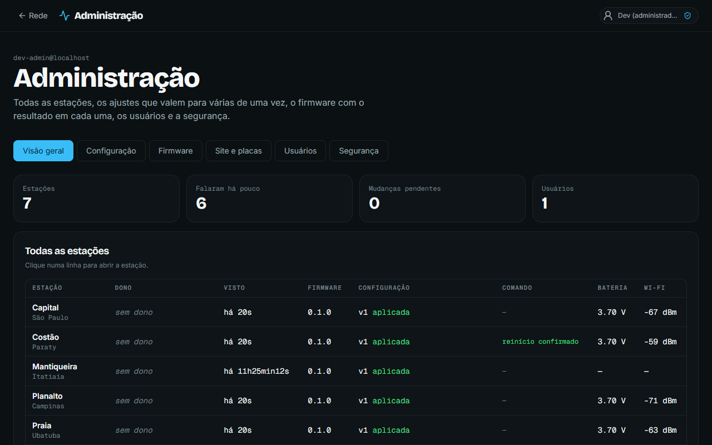

O **token de administrador** (`ADMIN_TOKEN`, segredo do Worker) é o jeito antigo, usado por scripts e pela API. O site só o pede quando **não há login com Google** configurado. Ele nunca é enviado: serve para assinar os pedidos. Em desenvolvimento está em `worker/.dev.vars`; publicado, defina com `npx wrangler secret put ADMIN_TOKEN` (não dá para lê-lo de volta).

### Que endereço a placa vai usar?

A placa guarda o endereço do site e envia as leituras para ele. O endereço certo depende de onde o site está:

| Situação | Endereço | Observação |
|---|---|---|
| Site publicado | `https://estacao-meteo.SEU-USUARIO.workers.dev` | O caso normal. Funciona de qualquer rede. |
| Teste no seu computador | `http://IP-DO-COMPUTADOR:8787`, por exemplo `http://192.168.1.2:8787` | O computador e a placa precisam estar **na mesma rede**. **`localhost` não serve**: para a placa, `localhost` é ela mesma. |

Para o teste local, suba a API aberta para a rede (`npm run dev:lan` na pasta `worker`). Na primeira vez o **firewall do Windows** pergunta se o Node/workerd pode usar a rede privada: **permita**. Para descobrir o IP do computador, rode `ipconfig` e olhe o "Endereço IPv4" do Wi-Fi.

Com `http://` a placa **assina** os envios e a chave não viaja, mas o conteúdo das leituras fica legível na rede. Para uso de verdade, prefira `https://`.

---

## 1. Conheça o site

Abra o site. A primeira tela é o **mapa da rede**: cada ponto é uma estação, com a leitura do momento. Estações que não enviam há um tempo aparecem como **sem sinal**.

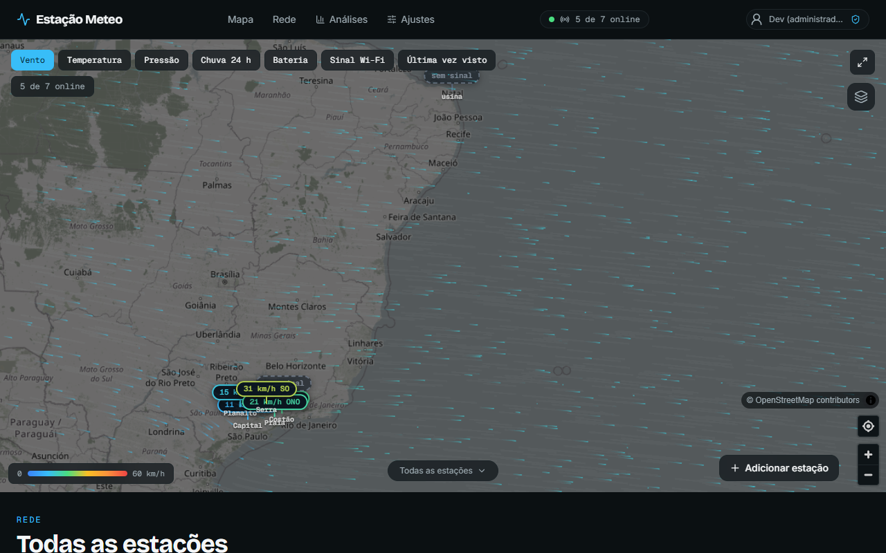

Ao abrir, o mapa vai para a **sua localização** (o navegador pede permissão; se negar, ele mostra as estações). O botão de camadas, no canto direito, troca o mapa de fundo entre **Escuro, Ruas, Satélite e Relevo**, e o botão de alvo, embaixo, volta para onde você está.

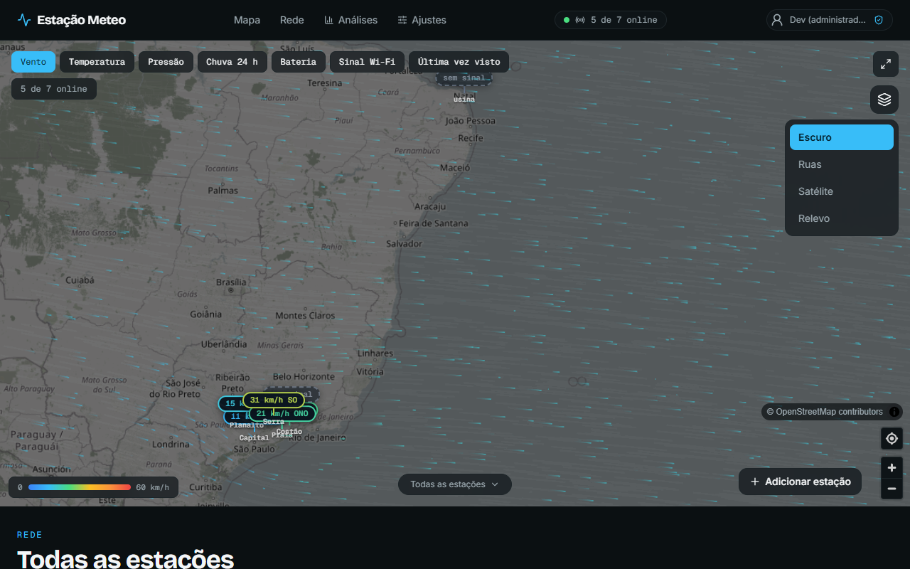

Os botões do topo (**Vento, Temperatura, Pressão, Chuva 24 h, Bateria, Sinal Wi-Fi, Última vez visto**) podem ser ligados **todos ao mesmo tempo**: cada estação mostra uma linha por camada ligada. Estação sem sensor de pressão mostra "—".

As camadas que abrem ligadas, as unidades (km/h, °C, hPa…) e o mapa de fundo padrão se escolhem em **Ajustes**:

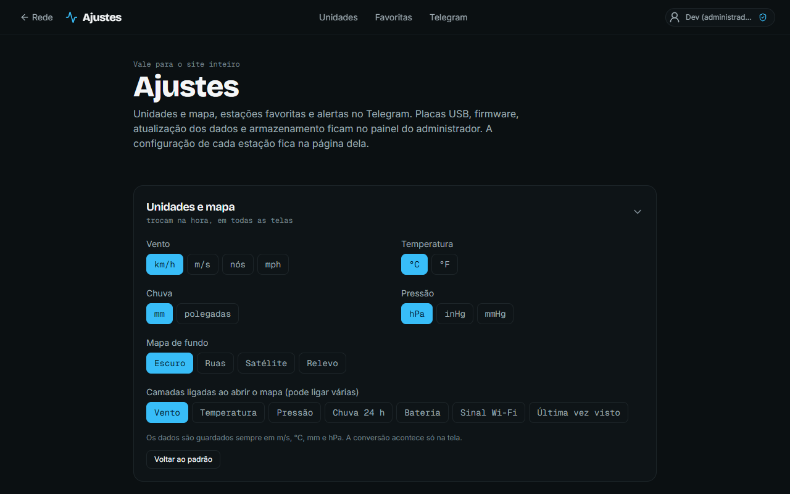

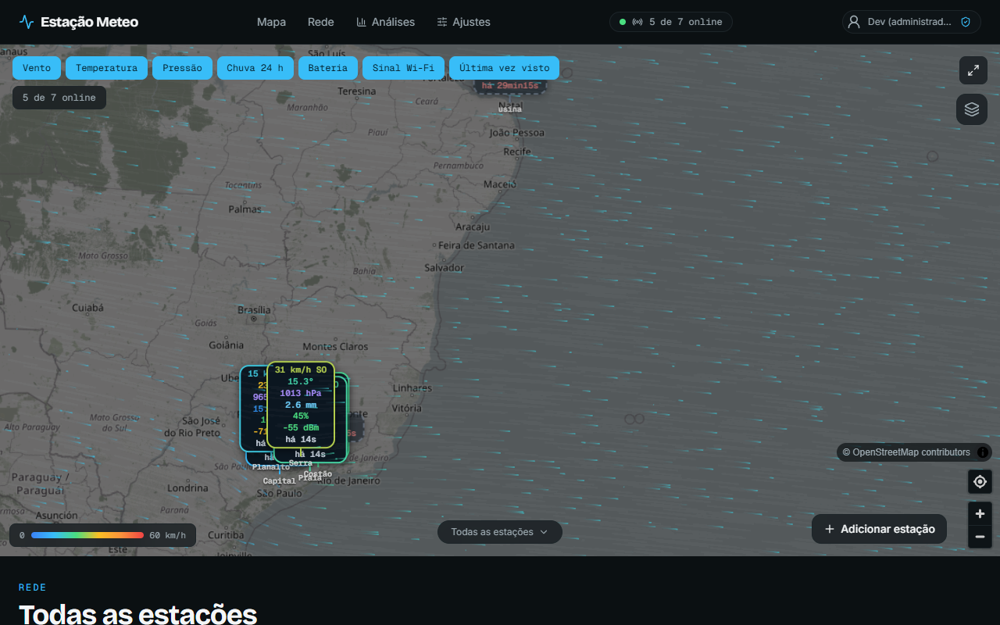

Para **editar ou remover** uma estação, clique no pino dela e depois em **Editar ou remover estação**. Remover apaga a estação, a chave e todas as leituras.

Os quatro lugares que você vai usar:

| Onde | Quem vê | Para quê |
|---|---|---|
| **Adicionar estação** (botão no mapa) | administrador | Cria a estação e gera um código de pareamento. |
| **Ajustes** (no topo do mapa) | todos | Unidades, mapa, estações favoritas e alertas no Telegram. |
| **Administração** (menu da conta → *Painel do administrador*) | administrador | Visão geral, configuração em massa, firmware, **Site e placas** (placa USB, gravar firmware, atualização dos dados, exportar e backup), usuários e segurança. |
| **Configurações** (página de cada estação) | dono e administrador | Placa, sensores e pinos, bateria, energia, intervalo de envio, calibração. |

---

## 2. Escolha o caminho

Há três jeitos de configurar a placa. Use o **Caminho A** se for a primeira vez: é o mais curto e o que dá menos erro.

| Caminho | Quando usar | Precisa de |
|---|---|---|
| **A. Pela USB** (recomendado) | A placa está ao lado do computador. | Cabo USB, Chrome/Edge/Opera, firmware com USB. |
| **B. Código de pareamento** | A placa vai para outra pessoa instalar em outro lugar. | Site em `https://`, placa já gravada. |
| **C. Portal do celular** | Nada acima funcionou. | Celular. |

---

## 3. Caminho A: pela USB (recomendado, só administrador)

Entre como administrador (veja acima) e abra **Administração → Site e placas**. Dois painéis interessam:

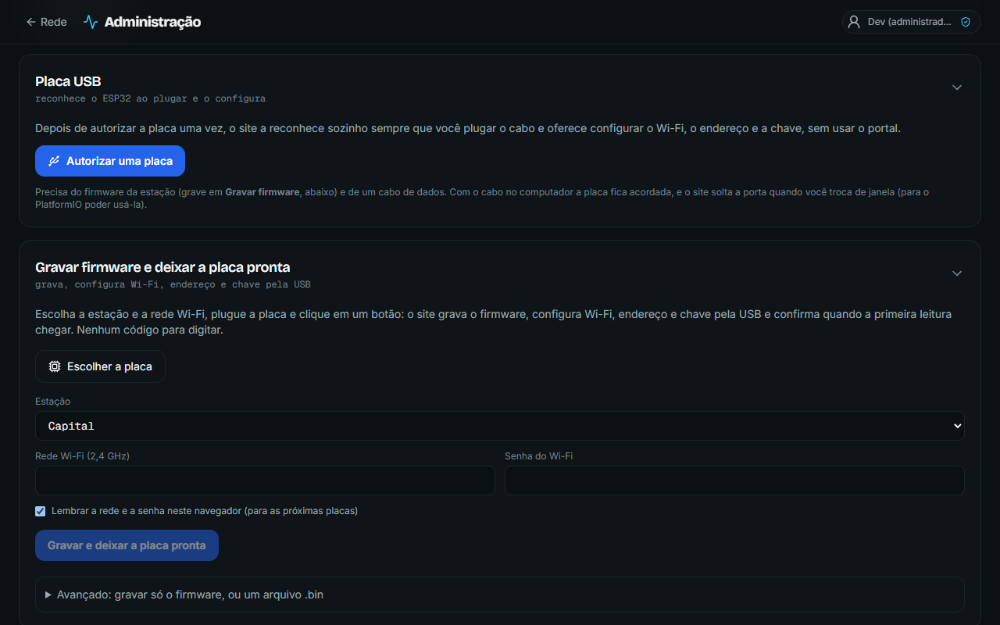

**Placa USB** → **Autorizar uma placa** (uma vez por navegador): depois disso o site reconhece a placa sempre que você plugar o cabo.

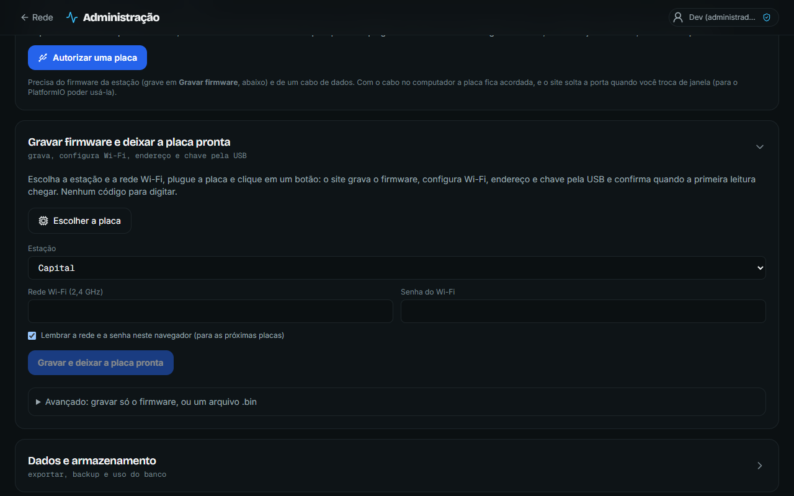

1. Em **Gravar firmware e deixar a placa pronta**, plugue a placa e clique em **Escolher a placa** (o navegador pede a porta serial uma vez).
2. Escolha a **estação** (ou *Nova estação…*, com nome, local e, se quiser, o e-mail do dono) e informe a **rede Wi-Fi de 2,4 GHz** e a senha. O site pode lembrar a rede para as próximas placas.
3. Clique em **Gravar e deixar a placa pronta**. O site grava o firmware, configura Wi-Fi, endereço do site e chave pela USB e avisa quando a primeira leitura chegar. Não há código para digitar: quem confirma é o seu login de administrador.

Se a placa estiver dormindo, o site pede para apertar RESET e continua sozinho. Usuários comuns não veem este painel nem o aviso de placa USB.

O que você vê durante o processo (aviso no canto da tela, em qualquer página do site):

| | |
|---|---|
| **Placa nova, sem firmware.** O aviso oferece gravar. 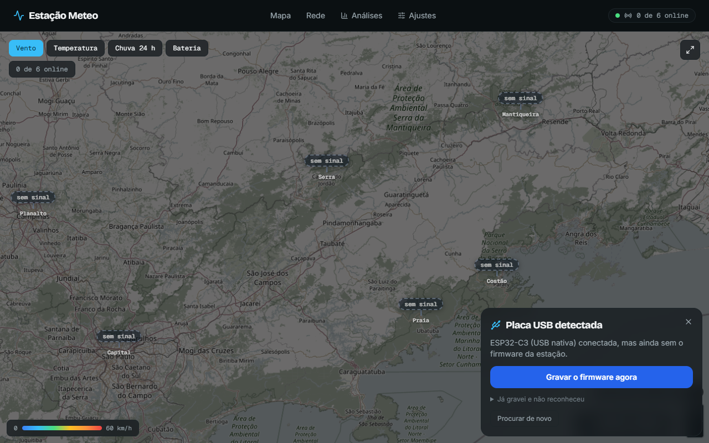 | **Placa detectada.** Escolha a estação e a rede Wi-Fi. 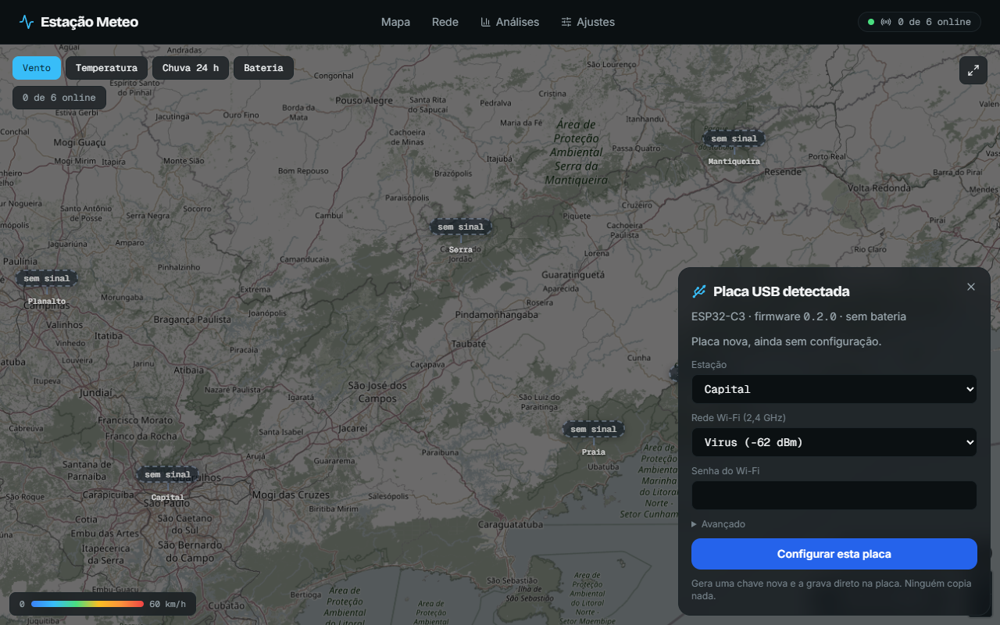 |
| **Configurando.** O site entrega Wi-Fi, endereço e chave. 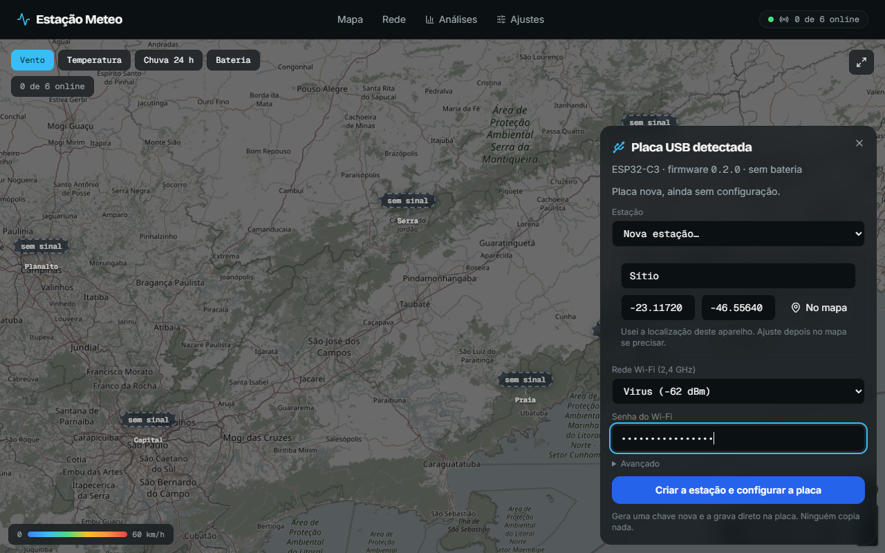 | **Aguardando a primeira leitura.** 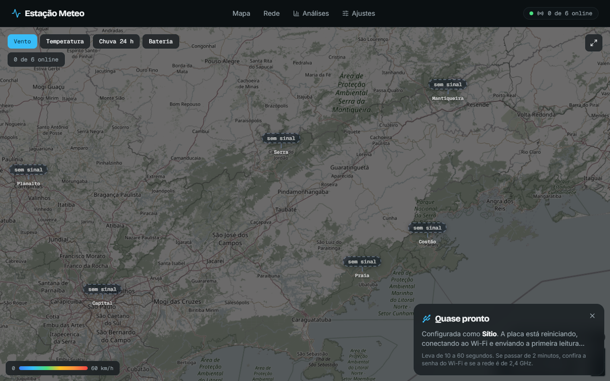 |

E, quando a primeira leitura chega:

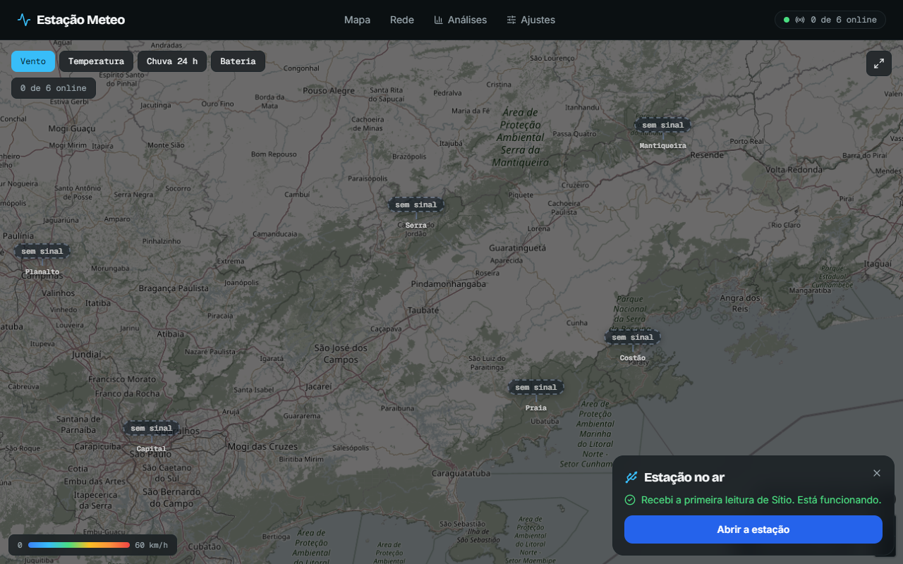

## 4. Caminho B: código de pareamento

Serve para mandar a placa a outra pessoa instalar, sem ela precisar de computador, token ou chave. **Só funciona com o site em `https://`**, porque a chave viaja na resposta.

1. **Você**, uma vez, grava a placa com a imagem **Campo** (passo 3.1) e a envia.
2. **Você** clica em **Adicionar estação** no mapa:

   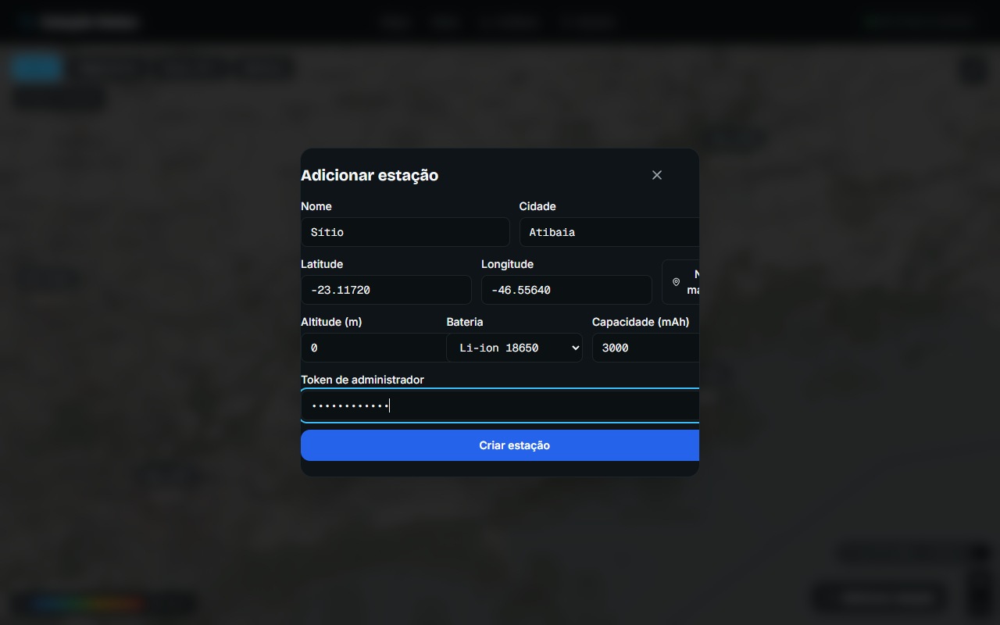

   Preencha nome, cidade, local, bateria (tipo e capacidade em mAh) e o token. Clique em **Criar estação**.
3. O site mostra o **código de pareamento**:

   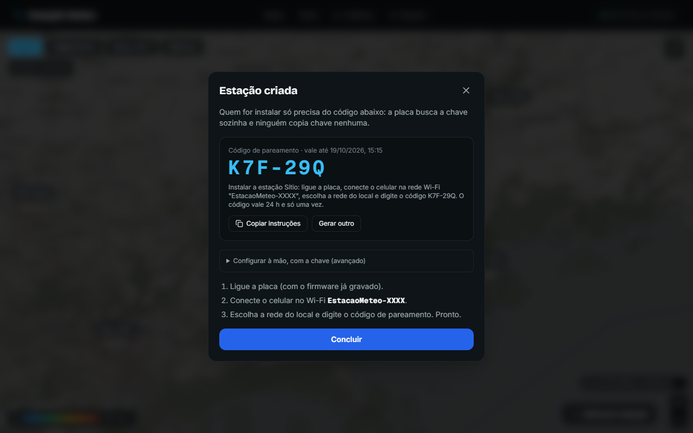

   O código vale **24 horas** e **uma vez só**, e gerar outro cancela o anterior. **Copiar instruções** copia um texto pronto para mandar a quem instala.
4. **Quem instala**: liga a placa, abre o Wi-Fi **EstacaoMeteo-XXXX** no celular, escolhe a rede do local, digita o código e salva.
5. A placa troca o código pela chave, e a estação aparece no site.

Para gerar outro código numa estação que já existe: página da estação → **Configurações → Gerar código de pareamento**.

---

## 5. Caminho C: portal do celular

Use se a USB não funcionou.

1. Ligue a placa **com bateria ou carregador, sem o cabo num computador** (com o cabo, ela espera a configuração pelo site). Sem Wi-Fi salvo, ela cria a rede **EstacaoMeteo-XXXX**. Se já tinha Wi-Fi salvo, **ligue a placa e, nos primeiros 6 segundos, aperte o botão BOOT** (GPIO9) por meio segundo. Não o segure ao ligar: com BOOT apertado no reset o ESP32-C3 entra em modo de gravação e não executa o firmware.
2. No celular, conecte nessa rede. Uma página de configuração abre sozinha (se não abrir, vá a `192.168.4.1`).
3. Escolha o Wi-Fi e a senha, informe o **endereço do site** e o **código de pareamento** (ou, à mão, o **ID** e a **chave do dispositivo**).
4. Salve. A placa mede, envia a primeira leitura e passa a seguir a rotina.

---

## 6. Depois que está no ar

A página da estação mostra a figura com os valores ao vivo:

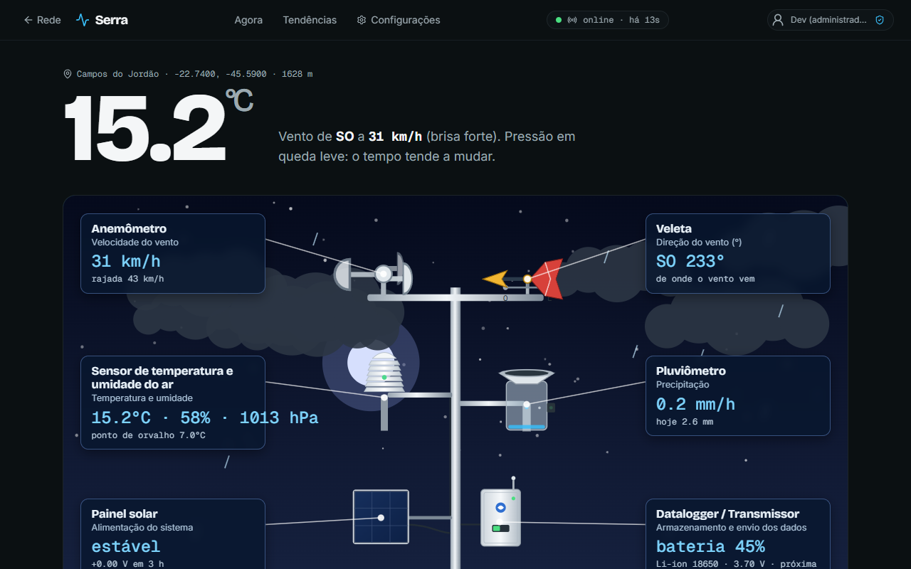

O botão **Configurações** (no topo) abre a parte técnica: consumo e autonomia, sensores, bateria, diagnóstico e a configuração remota. Na seção **Configuração**, os atalhos *Placa, sensores e pinos*, *Bateria*, *Envio, vento e economia* e *Nome e local* levam direto a cada grupo.

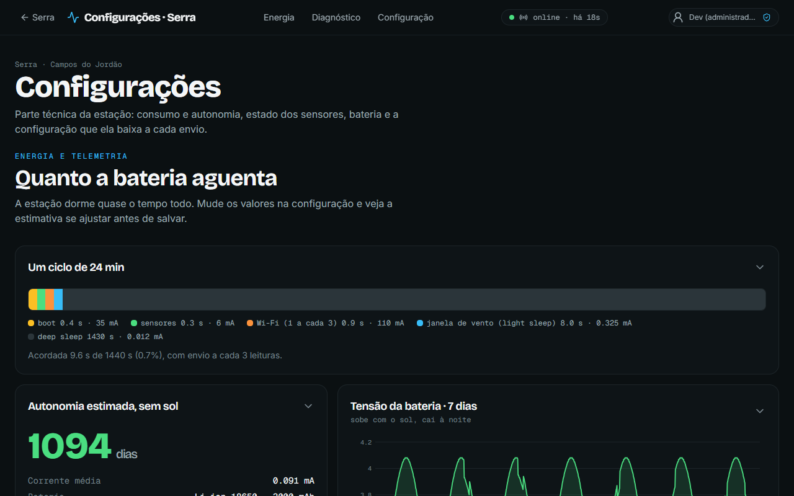

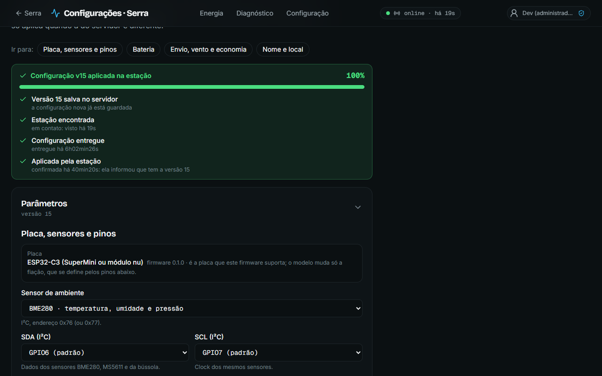

A **placa** mostrada é a que o firmware suporta (ESP32-C3). O **sensor de ambiente** pode ser BME280, MS5611 (GY-63), os dois, ou nenhum, e os **pinos** (SDA, SCL, vento, chuva, bateria) podem ser trocados. A fiação precisa ficar igual ao que o site mostra. Veja a pinagem em [hardware.md](hardware.md#pinagem-do-esp32-c3).

O que vale ajustar logo no começo:

| Ajuste | Para quê |
|---|---|
| **Sensor de ambiente** | Escolha o módulo que você ligou (BME280 é o padrão). Com o errado, a placa não mede e só manda o sinal de vida. |
| **Enviar a cada** = 1 | Só durante os testes: a estação envia a cada leitura, e as mudanças feitas no site chegam mais rápido. Depois volte ao padrão (3) para economizar bateria. |
| **Tipo e capacidade da bateria** | Define a curva de % da bateria e a autonomia estimada. |
| **Chuva por basculada** | Medido no seu pluviômetro. Veja [calibracao.md](calibracao.md). |
| **Ajuste do norte** | Para a direção do vento. Veja [calibracao.md](calibracao.md). |
| **Modo bancada** | Só em teste. Em campo, ponha 0. |

As mudanças ficam **pendentes** até a estação enviar de novo e confirmar. Não é erro, é só esperar.

---

## 7. Problemas comuns

Resumo do que mais acontece. A lista completa está em [solucao-de-problemas.md](solucao-de-problemas.md).

### "Token de administrador incorreto."

Só aparece quando o site **não tem login com Google** e usa o token (veja acima). Tem 3 causas:

1. **Token digitado diferente do segredo do servidor.** Em desenvolvimento, confira `worker/.dev.vars`. Publicado, redefina com `npx wrangler secret put ADMIN_TOKEN`.
2. **O servidor não foi reiniciado** depois de mudar o `.dev.vars`. Ele só lê o arquivo ao iniciar.
3. **O relógio do computador está errado.** O pedido é assinado com a hora e é recusado se a diferença passar de 2 minutos. Sincronize a hora do Windows.

Se um token errado ficou guardado no navegador, abra **Avançado → trocar o token de administrador** no aviso da placa e digite de novo.

### O aviso da placa não aparece

- O navegador é Chrome, Edge ou Opera? Em Firefox/Safari não funciona.
- O site está em `https://` ou `localhost`? A Web Serial não funciona em `http://` com IP. Para o teste local, abra o site por `http://localhost:5173`.
- A placa foi autorizada em **Administração → Site e placas → Placa USB**?
- Você entrou como **administrador**? Usuário comum não vê o aviso.
- O cabo é de dados? Tente outro.
- Outro programa está usando a porta (monitor serial do PlatformIO, Arduino IDE)? Feche.

### A gravação falha ao conectar

Troque o cabo, feche programas que usam a porta e tente de novo. Em placas com ponte CH340/CP210x: segure **BOOT**, aperte **RESET**, solte o RESET e depois o BOOT. A USB nativa do ESP32-C3 entra em modo de gravação sozinha.

### A placa foi configurada mas nunca chega a leitura

| Sintoma | Causa mais provável |
|---|---|
| Passa de 2 minutos em "Quase pronto" | Senha do Wi-Fi errada, ou rede de **5 GHz**. |
| Conecta mas não envia | A placa **não alcança o endereço do site**. Em teste local, confira o IP, se o `dev:lan` está rodando e se o firewall do Windows liberou o Node/workerd. |
| Estação aparece como "atrasada" | Já passou de 2,5 intervalos sem leitura. Com envio em lote, o intervalo efetivo é `intervalo × enviar a cada`. |

### O endereço do site gravado na placa está errado

Em **Avançado → Endereço do site**, corrija e configure a placa de novo (o aviso tem o botão **Configurar de novo**). Para mudar o endereço embutido nas imagens de fábrica, gere-as de novo com `python tools/make_factory.py --server https://seu-site` (veja [firmware.md](firmware.md)).

### Perdi a chave / quero recomeçar a placa

Configure de novo pelo aviso (3.3): isso **gera uma chave nova** e invalida a anterior. Para limpar tudo na placa, marque **Apagar toda a flash antes** ao gravar (remove Wi-Fi, chave e calibração).

---

## 8. Próximos passos

- [hardware.md](hardware.md): ligações e montagem física
- [calibracao.md](calibracao.md): direção, velocidade, chuva
- [energia.md](energia.md): consumo e autonomia
- [firmware.md](firmware.md): como a placa funciona por dentro
- [implantacao.md](implantacao.md): publicar o site na Cloudflare
