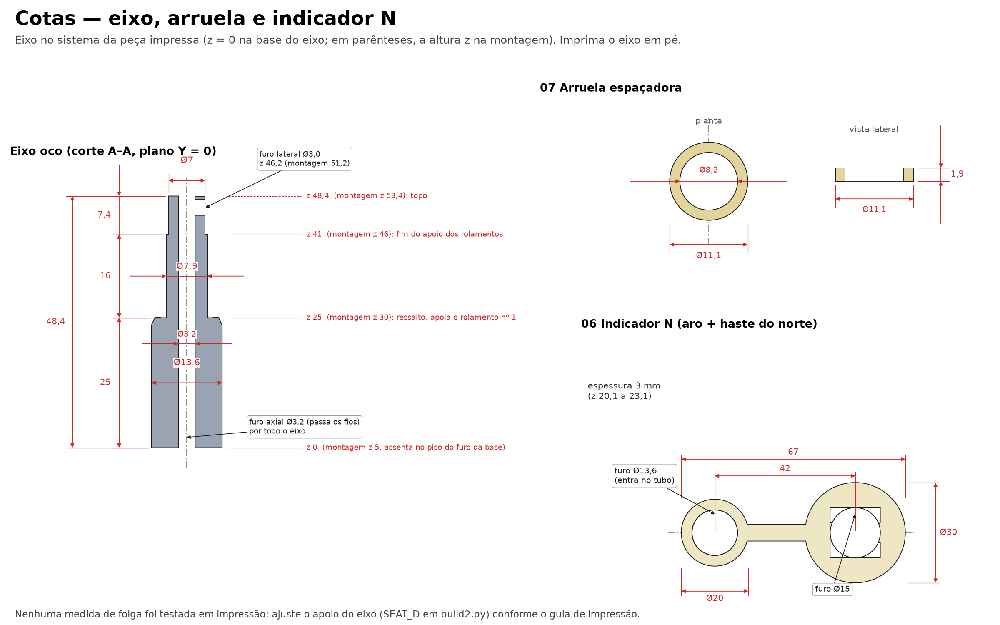

# Montagem 3D: impressão

Segundo guia da série (anterior: [peças e materiais](montagem-3d-pecas-e-materiais.md)). Aqui estão o material, a orientação de cada peça e o teste que deve ser feito **antes** de imprimir o conjunto.

As cotas de cada peça estão nas imagens [eixo, arruela e indicador N](../adaptacao_sensores_v2/06_cotas_eixo_arruela_indicador.png), [base](../adaptacao_sensores_v2/07_cotas_base.png) e [biruta, rotor e braço](../adaptacao_sensores_v2/08_cotas_biruta_rotor_braco.png).

## Material e parâmetros de partida

| Item | Sugestão |
|---|---|
| Material | **PETG** ou **ASA** para uso externo. PLA só para teste na bancada: amolece ao sol e perde a forma. |
| Bico e camada | 0,4 mm e 0,2 mm |
| Perímetros | 3 ou mais |
| Preenchimento | 20 a 30 % |
| Compensação horizontal de furos | Comece em 0 e ajuste pelo teste abaixo |
| Cor | Clara, para esquentar menos |

## Orientação de cada peça

| Peça | Orientação | Cuidado |
|---|---|---|
| 01 base | Face da placa (Ø50) na mesa | O bolso do GY-273 abre para a mesa; o teto dele é uma **ponte de cerca de 19 mm**. Use suporte se afundar. |
| 02 eixo | **Em pé** | O furo lateral de Ø3 mm é uma ponte curta. Imprima devagar e com ventilação forte. Veja a seção do apoio abaixo. |
| 03 biruta | Como no modelo original (placa deitada) | O anel do rolamento tem lábio de 1 mm; não amasse o primeiro anel. |
| 04 rotor | Como no original (copos para cima) | Os copos têm suportes. Remova sem danificar o cubo do rolamento. |
| 05 braço | Colar para cima | O bolso do A3144 fica aberto no topo. |
| 06 indicador N, 07 arruela | Deitados | Sem exigências. |

## Medidas críticas

| Peça | Medida | Valor de projeto | Para o quê |
|---|---|---|---|
| 02 eixo | Apoio dos rolamentos (z 30 a 46) | **Ø7,9 mm** | Entra no furo de 8 mm do 608ZZ |
| 02 eixo | Topo (z 46 a 53,4) | Ø7,0 mm | Passa pelo teto do rotor (furo Ø7,5) e recebe o colar do braço (furo Ø7,2) |
| 02 eixo | Furo axial / furo lateral | Ø3,2 / Ø3,0 mm | Fios do Hall |
| 03 biruta, 04 rotor | Alojamento do rolamento | Ø22 mm × 7 mm | Rolamento por pressão |
| 01 base | Furo do eixo | Ø13,5 mm | Eixo de Ø13,6 mm na parte de baixo, por pressão |
| 07 arruela | Furo | Ø8,2 mm | Folga sobre o eixo de Ø7,9 mm |

## Teste de encaixe do 608ZZ (faça primeiro)

A impressora decide se o conjunto funciona. Gaste meia hora antes de gastar o filamento todo:

1. Imprima **só o eixo (02)**, em pé, com a configuração final.
2. Meça com o paquímetro o apoio dos rolamentos em três alturas e em dois ângulos. O alvo é **7,90 a 7,95 mm**.
3. Deslize um 608ZZ pelo apoio: deve entrar com leve resistência da mão, sem martelar, e girar sem arrastar.

| Resultado | O que fazer |
|---|---|
| Não entra, ou entra apertado e o rolamento fica áspero | Lixe o apoio com lixa 800 girando a peça, ou reduza `SEAT_D` em `fonte/build2.py` (para 7,85, por exemplo) e gere de novo |
| Entra solto, com folga visível | Aumente `SEAT_D` (até 7,95) ou use uma gota de trava-rosca fraca |
| Entra bem | Siga |

Repita para os alojamentos: imprima um anel de teste (ou a biruta) e prove o rolamento de Ø22 mm. Ele deve entrar por pressão firme e **ficar parado**. Se estiver solto, use uma gota de cola cianoacrilato nas bordas. Se estiver apertado demais, passe uma lixa fina no furo.

## Depois da impressão

- Retire os suportes e as rebarbas, sobretudo no furo axial do eixo e no passa-fios da base.
- Passe uma broca de Ø3 mm (a mão) nos furos de fio para garantir passagem.
- Não lixe o lábio do alojamento da biruta: ele sustenta o rolamento.
- Para uso externo, veja [montagem-3d-testes-e-manutencao.md](montagem-3d-testes-e-manutencao.md#uso-externo).

## Próximo guia

[Montagem mecânica](montagem-3d-passo-a-passo.md).
