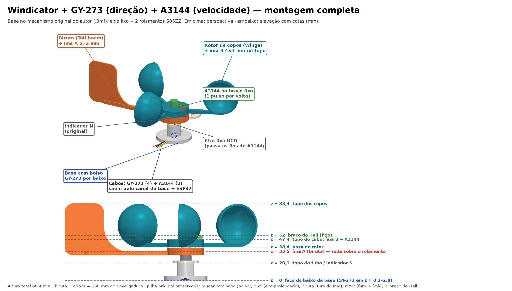
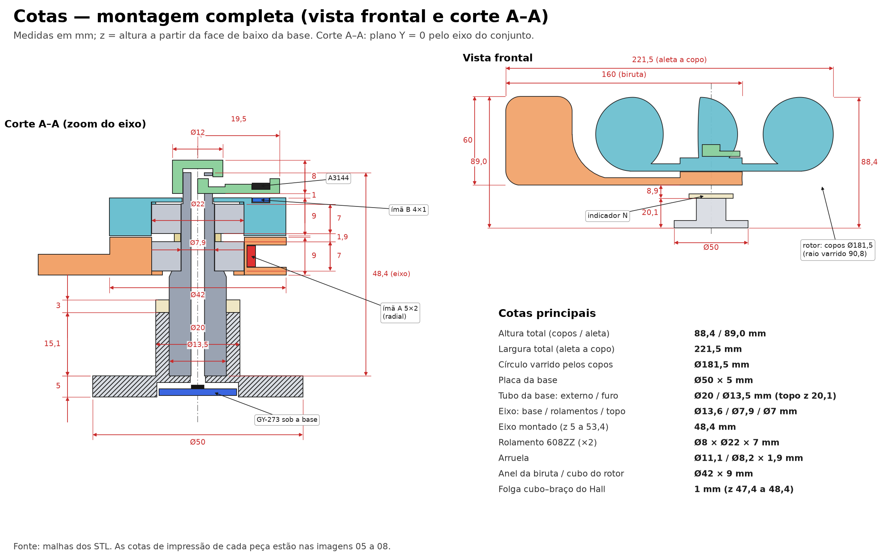

# Montagem 3D: montagem mecânica

Terceiro guia da série (anterior: [impressão](montagem-3d-impressao.md)). Monta a base, o eixo, a biruta e o rotor. Os sensores e os fios vêm no [próximo guia](montagem-3d-sensores-e-fiacao.md), mas **leia-o antes**: o GY-273 é colado na base *antes* do eixo, e os fios do Hall passam pelo eixo *antes* de o braço ser fixado.

## Pilha de peças (alturas em mm, a partir da face de baixo da base)

| z | O que está ali |
|---|---|
| 0 a 5 | Placa da base (Ø50) |
| 5 | Piso do furo da base: o eixo assenta aqui |
| 20,1 | Topo do tubo da base; aro indicador N (z 20,1 a 23,1) |
| 29 a 38 | Anel da biruta; lábio de 1 mm em z 29 a 30 |
| 30 a 37 | **Rolamento 608ZZ nº 1** |
| 37 a 38,9 | Arruela espaçadora |
| 38,4 a 47,4 | Cubo do rotor |
| 38,9 a 45,9 | **Rolamento 608ZZ nº 2** |
| 48,4 a 56,4 | Braço do Hall (colar prensado no topo do eixo) |
| 88,4 | Topo dos copos |

## Antes de começar

- Todas as peças limpas e sem rebarbas, e o teste de encaixe do 608ZZ feito (veja [impressão](montagem-3d-impressao.md#teste-de-encaixe-do-608zz-faça-primeiro)).
- GY-273 já soldado e colado no bolso da base (veja [sensores e fiação](montagem-3d-sensores-e-fiacao.md#gy-273-direção)).

## Passos

1. **Eixo na base.** Empurre o eixo no furo da base até o piso (z = 5). Se precisar de força, use um pedaço de madeira sobre o topo; não bata direto, que o topo é fino. O furo axial do eixo deve ficar alinhado com o passa-fios da base.
2. **Indicador N.** Encaixe o aro no eixo, apoiado no topo do tubo (z 20,1). Ele só é alinhado com o norte na instalação.
3. **Rolamento nº 1 na biruta.** Pressione o 608ZZ no anel da biruta até apoiar no lábio. Empurre pelo anel externo, sem forçar a pista interna. Gire com o dedo: deve girar sem raspar.
4. **Biruta no eixo.** Encaixe o conjunto no eixo, deslizando sobre o apoio de Ø7,9 mm até o ressalto (z = 30). A pista interna do rolamento deve encostar no ressalto.
5. **Ímã A.** Veja [sensores e fiação](montagem-3d-sensores-e-fiacao.md#ímãs). Feche o túnel só depois de conferir a polaridade.
6. **Arruela.** Coloque a arruela sobre o eixo. Ela encosta **só na pista interna** do rolamento nº 1 e separa as duas pistas internas; não deve tocar no anel da biruta nem no cubo do rotor.
7. **Rolamento nº 2 no rotor.** Pressione o segundo 608ZZ no cubo do rotor.
8. **Rotor no eixo.** Encaixe o rotor: o topo do eixo (Ø7) passa pelo furo do teto (Ø7,5). Gire com o dedo.
9. **Ímã B.** No bolso do topo do cubo (veja o guia de sensores).
10. **Braço do Hall.** Depois de passar os fios (guia de sensores), encaixe o colar do braço no topo do eixo por pressão e cole com uma gota de epóxi se ficar solto. A barra do braço fica 1 mm acima do cubo.

## Conferência final

- A biruta e o rotor giram **livres**, sem arrastar, nos dois sentidos.
- A aleta da biruta não toca os copos (ela fica fora do círculo varrido por eles).
- Entre o cubo e o braço há uma **folga de cerca de 1 mm**: o rotor não pode raspar.
- Não há folga axial perceptível (balance para cima e para baixo).
- A base está firme, com 3 parafusos M4 nos furos Ø5 mm (a 17,5 mm do centro).

## Fixação

A base tem três furos para M4 e um canal de cabos que sai para o lado −Y. Fixe o conjunto **nivelado**: a biruta e o rotor giram sobre um eixo vertical, e uma base inclinada faz a biruta parar de um lado. Use um nível de bolha. Altura, local e alinhamento do norte estão em [hardware.md](hardware.md#instalação) e [calibracao.md](calibracao.md).

## Próximo guia

[Sensores e fiação](montagem-3d-sensores-e-fiacao.md).
