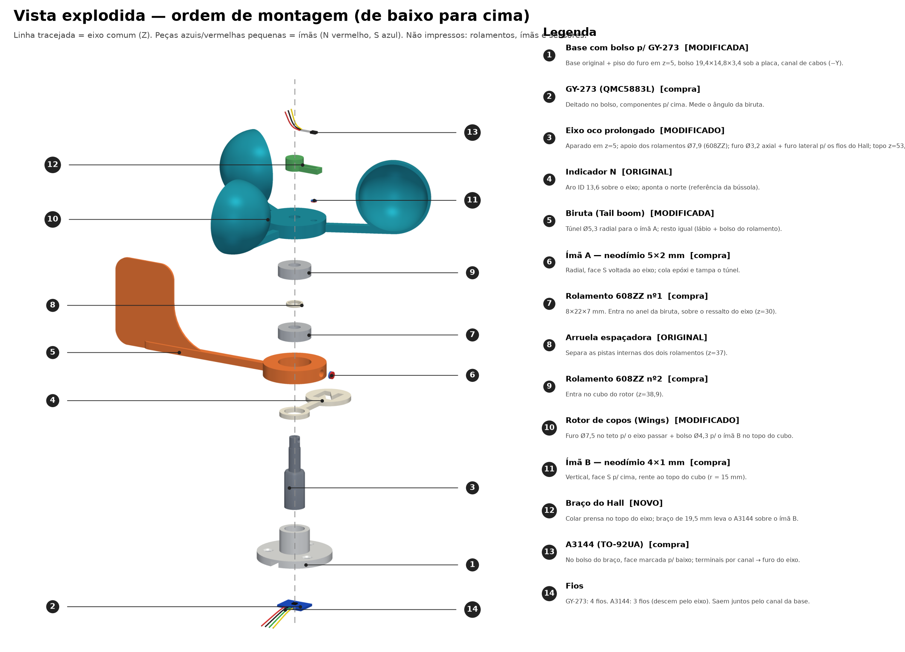
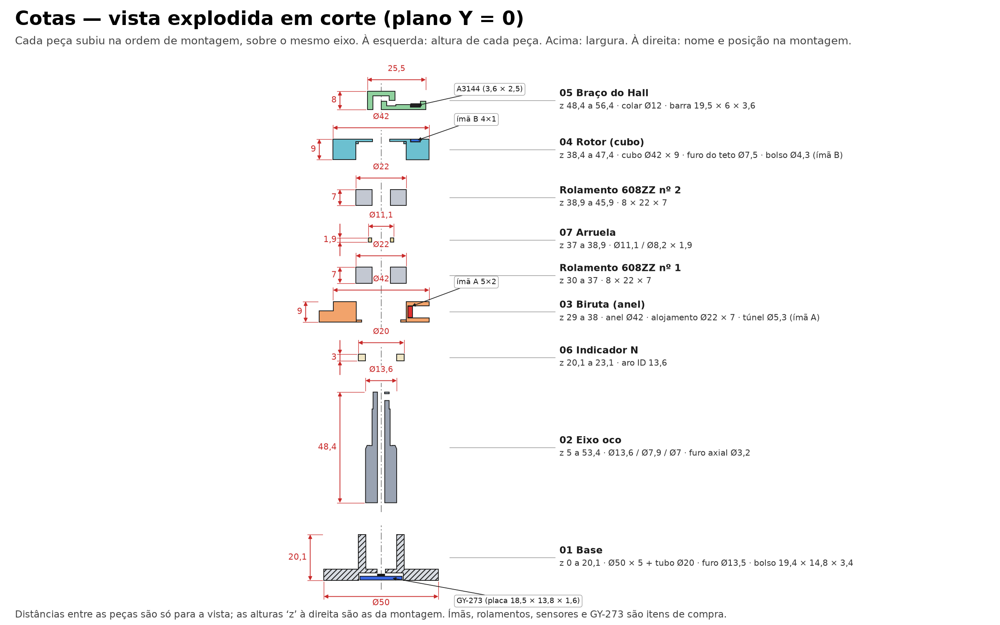

# Montagem 3D: peças e materiais

Primeiro de cinco guias sobre o anemômetro e a biruta (Windicator V2.0 Compact adaptado). Siga na ordem: **peças e materiais** → [impressão](montagem-3d-impressao.md) → [montagem](montagem-3d-passo-a-passo.md) → [sensores e fiação](montagem-3d-sensores-e-fiacao.md) → [testes e manutenção](montagem-3d-testes-e-manutencao.md).

> **Status:** o projeto de CAD existe, mas **nada foi impresso nem testado em hardware**. As medidas de folga abaixo são pontos de partida; ajuste na primeira peça. Sobre a licença das peças, veja [THIRD_PARTY.md](../THIRD_PARTY.md).

## Peças impressas (7)

Os arquivos ficam em [adaptacao_sensores_v2/](../adaptacao_sensores_v2/README.md). Se não os tiver, gere-os com `fonte/build2.py` a partir do modelo original.

| Arquivo | Peça | Origem |
|---|---|---|
| `01_base_com_bolso_GY273.stl` | Base com bolso do GY-273 e canal de cabos | Modificada |
| `02_eixo_oco_prolongado.stl` | Eixo fixo, oco, com apoio de Ø7,9 mm para o 608ZZ | Modificada |
| `03_biruta_com_furo_do_ima.stl` | Biruta com túnel do ímã A | Modificada |
| `04_rotor_copos_ima_e_furo.stl` | Rotor de copos com furo no teto e bolso do ímã B | Modificada |
| `05_braco_do_hall.stl` | Braço fixo que segura o A3144 | Nova |
| `06_indicador_N_original.stl` | Aro indicador do norte | Original |
| `07_arruela_original.stl` | Arruela espaçadora (furo Ø8,2 mm) | Original |

`Windicator_sensores_placa.3mf` traz as sete numa mesma mesa (cerca de 216 × 219 mm) para o Bambu Studio ou o PrusaSlicer.

## Itens de compra

| Qtde | Item | Observação |
|---|---|---|
| 2 | Rolamento **608ZZ** (8×22×7 mm) | Veja a próxima seção |
| 1 | GY-273 (QMC5883L) | Confira o chip: HMC5883L não funciona com este firmware |
| 1 | Sensor Hall do anemômetro | A3144 nos testes; para bateria, DRV5032 (veja [hardware.md](hardware.md#escolha-do-sensor-hall)) |
| 1 | Ímã de neodímio 5×2 mm | Ímã A, na biruta |
| 1 | Ímã de neodímio 4×1 mm | Ímã B, no rotor |
| 1 | Resistor de pull-up | 10 kΩ (A3144) ou 1 MΩ (DRV5032) |
| 0,5 m | Fio 28 AWG, 7 condutores ou mais | 4 do GY-273 e 3 do Hall |
| 3 | Parafusos M4 | Furos Ø5 mm da base, a 17,5 mm do centro |
| — | Epóxi de 5 min, fita Kapton | Ímãs, placa e sensor |

## O rolamento 608ZZ

| Medida | Valor |
|---|---|
| Furo (interno) | 8 mm |
| Diâmetro externo | 22 mm |
| Largura | 7 mm |
| Sufixo ZZ | Duas blindagens metálicas |

- É o rolamento mais comum do mercado (patins, *spinners*, impressoras 3D). Compre dois da mesma marca.
- **2RS** (borracha) também serve e protege melhor da poeira, mas tem mais atrito de partida. Para vento fraco, prefira ZZ e vedação por fora.
- O 627ZZ (7 mm de furo) **não serve** neste modelo: o eixo foi ajustado para 8 mm. As versões anteriores desta documentação citavam 627ZZ, pela suposição de que o eixo era de 7 mm. As medidas do arquivo original (eixo de Ø8,25 mm e arruela de furo Ø8,2 mm) já eram de 8 mm.
- O diâmetro externo e a largura são iguais aos do 627ZZ, então os alojamentos de Ø22 mm × 7 mm da biruta e do rotor não mudaram.
- Rolamentos de aço desviam um pouco o campo do ímã A. Veja [calibracao.md](calibracao.md).

## Ferramentas

- Paquímetro (essencial para o teste de encaixe).
- Lima fina ou lixa 400 a 800, estilete para rebarbas.
- Pinça, ferro de solda, termorretrátil fino.
- Mistura de epóxi e palito; fita adesiva de papel.
- Multímetro.
- Uma broca de Ø3 mm para limpar a passagem dos fios, se precisar.

## Próximo guia

[Impressão](montagem-3d-impressao.md).
