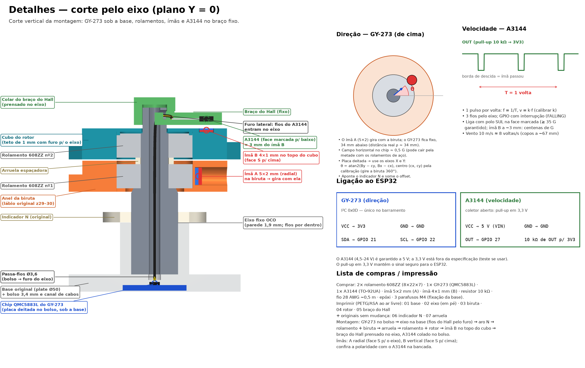

# Montagem 3D: sensores e fiação

Quarto guia da série (anterior: [montagem mecânica](montagem-3d-passo-a-passo.md)). O vento usa dois sensores: o **GY-273** (QMC5883L) mede a direção e o **Hall** mede a velocidade.

## GY-273 (direção)

O chip fica **fixo**, num bolso sob a base, e lê o ímã A, que gira junto com a biruta. A placa fica deitada, e os eixos úteis são X e Y.

1. Solde **4 fios** (VCC, GND, SDA, SCL) direto nos pads, sem barra de pinos, com os componentes para cima.
2. Cole no bolso (19,4 × 14,8 × 3,4 mm) com epóxi ou fita Kapton. Passe os fios pelo canal (6 × 3,4 mm) que sai pela borda (−Y).
3. Confira com o multímetro que não há curto entre VCC e GND antes de fechar.

O GY-273 tem endereço I²C fixo **0x0D**.

## Ímãs

| Ímã | Medida | Onde | Polaridade |
|---|---|---|---|
| A (direção) | 5×2 mm | Túnel radial da biruta, no lado oposto à aleta | Face **S voltada para o eixo** |
| B (velocidade) | 4×1 mm | Bolso no topo do cubo do rotor, a 15 mm do eixo | Face **S para cima**, rente à superfície |

- Para achar o polo S, use uma bússola: o lado do ímã que **atrai a ponta N** da agulha é o polo S. Marque com caneta.
- Cole com epóxi. No ímã A, feche o túnel com epóxi só depois de conferir a polaridade.
- O ímã A fica do lado do bico, então o ângulo do ímã é o ângulo de **onde o vento vem**.
- Mantenha o ímã A longe do Hall: ele pode causar pulsos falsos (veja [testes e manutenção](montagem-3d-testes-e-manutencao.md#pulsos-falsos-no-hall)).

## Sensor Hall (velocidade)

O Hall fica **fixo** no braço e vê o ímã B passar a cada volta do rotor: 1 pulso por volta.

1. Solde **3 fios** (VCC, GND, OUT) nos terminais e isole com termorretrátil.
2. Passe os três fios **de baixo para cima**: do bolso da base, pelo passa-fios Ø3,6 e pelo furo axial (Ø3,2) do eixo, até saírem pelo **furo lateral** (z ≈ 51).
3. Encaixe o braço no topo do eixo, passando os fios pela janela do colar e pelo canal da barra, até o bolso.
4. Assente o sensor no bolso (**face marcada para baixo**, terminais para o colar) e cole.
5. Cubra o canal com fita.

O furo do eixo tem Ø3,2 mm: três fios de 28 AWG passam folgados. Com fios mais grossos, não force.

### Escolha do sensor

O A3144 só é garantido a 5 V e consome até 4,4 mA o tempo todo: serve para testes. Numa estação a bateria, use o DRV5032 (omnipolar, microamperes) com o pull-up adequado. A comparação está em [hardware.md](hardware.md#escolha-do-sensor-hall). O A3144 liga **só com polo sul** na face marcada; o DRV5032 não depende do polo.

## Ligação à estação

Os GPIOs de SDA, SCL e vento são definidos na configuração da estação; a pinagem do ESP32-C3 está em [hardware.md](hardware.md#pinagem-do-esp32-c3). Os GPIOs 21, 22 e 27 do exemplo em [adaptacao_sensores_v2/](../adaptacao_sensores_v2/README.md) são de um ESP32 comum e **não valem** para o ESP32-C3.

| Sensor | Pino do sensor | Ligação |
|---|---|---|
| GY-273 | VCC, GND | 3,3 V, GND |
| | SDA, SCL | SDA e SCL da estação |
| Hall | VCC | 3,3 V (DRV5032) ou 5 V (A3144) |
| | GND | GND |
| | OUT | GPIO de vento, com pull-up para 3,3 V |

- Com o A3144 a 5 V, o pull-up em 3,3 V mantém o sinal seguro para o ESP32.
- Cabo de até cerca de 1 m para o I²C.
- A calibração (direção, norte e fator de velocidade) está em [calibracao.md](calibracao.md).

## Próximo guia

[Testes e manutenção](montagem-3d-testes-e-manutencao.md).
